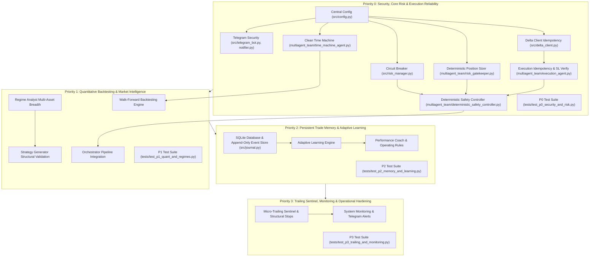

# DELTA EXCHANGE MULTI-AGENT QUANTITATIVE TRADING BOT
## Comprehensive Implementation Plan & Engineering Roadmap

---

## 1. Plan Overview & Dependency Graph

---

## 2. Priority Zero (P0): Security & Critical Risk Hardening

### P0.1: Central Validated Configuration (`src/config.py`)
- **Objective:** Create a unified Pydantic/dataclass configuration module reading strictly from environment variables with deterministic defaults.
- **Key Parameters:**
  - `MAX_RISK_PER_TRADE_PCT`: float (default 0.01)
  - `MAX_DOLLAR_RISK_PER_TRADE`: float (default 4.00)
  - `MAX_DAILY_DRAWDOWN_PCT`: float (default 0.03)
  - `MAX_WEEKLY_DRAWDOWN_PCT`: float (default 0.05)
  - `MAX_MONTHLY_DRAWDOWN_PCT`: float (default 0.08)
  - `MAX_CONSECUTIVE_LOSSES`: int (default 3)
  - `COOLDOWN_SECONDS`: int (default 1800)
  - `APPROVAL_EXPIRY_SECONDS`: int (default 300)
  - `TELEGRAM_BOT_TOKEN`, `TELEGRAM_CHAT_ID`, `AUTHORIZED_USER_IDS`: list of allowed user IDs
- **Dependencies:** None.

### P0.2: Telegram Security & Authenticated Approvals (`src/telegram_bot.py`, `src/telegram_notifier.py`)
- **Objective:** Eliminate hardcoded tokens, authenticate callback senders, bind approvals cryptographically to exact trade parameters, expire stale requests, and enforce fresh market data.
- **Implementation Steps:**
  1. Remove all hardcoded string tokens and chat IDs.
  2. Implement `_is_user_authorized(user_id)` checking against configured `AUTHORIZED_USER_IDS` and `TELEGRAM_CHAT_ID`.
  3. Generate cryptographic proposal tokens: `nonce = sha256(trade_id + symbol + side + entry + sl + tp + contracts + expiry)`.
  4. In `request_trade_confirmation`, enforce:
     - Check callback sender `user_id`.
     - Reject if expired (`time.time() > expiry`).
     - Reject if parameter drift occurs between proposal and execution.
     - Mandate live market data refresh: if `get_ticker` fails or returns stale data ($> 30\text{s}$), **abort approval immediately**.
  5. Record approval/rejection audit trail to SQLite / state store.
  6. Remove synthetic/fabricated backtest text from proposal templates.

### P0.3: Deterministic Position Sizing & Hard Risk Bounds (`multiagent_team/risk_gatekeeper.py`)
- **Objective:** Ensure AI confidence cannot increase maximum dollar risk, prevent forcing minimum lot sizes that exceed risk, and compute accurate liquidation buffers.
- **Implementation Steps:**
  1. Set `hard_dollar_risk_limit = min(total_equity * max_risk_pct, max_dollar_risk_cap)`. AI conviction may down-scale risk (for lower conviction), but **never scale risk above 1.0x hard limit**.
  2. For contract sizing:
     - `raw_contracts = int(hard_dollar_risk_limit / risk_per_contract)`.
     - `aligned_contracts = (raw_contracts // lot_size) * lot_size`.
     - **Critical Rule:** If `aligned_contracts < lot_size`, return `NO_TRADE` with reason `"Minimum tradable contract size exceeds risk budget"`. **Never force `max(lot_size, raw_contracts)`**.
  3. Query Delta Exchange instrument metadata for `contract_value`, `tick_size`, `maintenance_margin_rate`, `lot_size`.
  4. Compute authoritative liquidation price using maintenance margin:
     - Long: $P_{liq} = \frac{P_{entry} \times (1 - \frac{1}{\text{leverage}})}{1 - \text{MMR}}$.
     - Short: $P_{liq} = \frac{P_{entry} \times (1 + \frac{1}{\text{leverage}})}{1 + \text{MMR}}$.
     - Require $|P_{entry} - P_{liq}| \ge 3.0 \times |P_{entry} - P_{sl}|$. If closer, clamp leverage downward until safe, or reject trade.

### P0.4: Persistent Multi-Horizon Circuit Breaker (`src/risk_manager.py`)
- **Objective:** Implement fail-closed circuit breaker with states `TRADING_ALLOWED`, `COOLDOWN`, `HALTED`, `EMERGENCY`.
- **Implementation Steps:**
  1. Maintain persistent state file: `starting_equity_daily`, `starting_equity_weekly`, `starting_equity_monthly`, `peak_equity`, `consecutive_losses`, `state`, `halt_reason`, `halt_timestamp`, `cooldown_until`.
  2. Implement evaluation logic:
     - Daily drawdown $> 3\% \to$ `HALTED` (until calendar day reset AND explicit reset confirmation).
     - Weekly drawdown $> 5\% \to$ `HALTED` (cannot reset until next week or admin override).
     - Monthly drawdown $> 8\% \to$ `EMERGENCY` (trading ceased indefinitely).
     - Consecutive losses $\ge 3 \to$ `COOLDOWN` (trading suspended for configurable `cooldown_seconds`).
  3. **Fail-Closed Rule:** If circuit breaker state file is missing or corrupted, state immediately defaults to `HALTED`.
  4. Add administrative reset method: `manual_reset_circuit_breaker(authorized_by)`.

### P0.5: Remove Fabricated Backtest Approvals (`multiagent_team/time_machine_agent.py`)
- **Objective:** Eliminate synthetic win rates and assumed baseline statistics.
- **Implementation Steps:**
  1. Remove `APPROVED_STATISTICAL_BASELINE` and `APPROVED_SYNTHETIC_REGIME`.
  2. If historical candles $< 60$, return: `passed = False, verdict = "INSUFFICIENT_DATA"`.
  3. If matched pattern sample size $< min\_sample\_size$, return: `passed = False, verdict = "INSUFFICIENT_SAMPLE"`.
  4. If out-of-sample sample size is too small, return: `passed = False, verdict = "INSUFFICIENT_OOS_SAMPLE"`.
  5. Only return `passed = True, verdict = "APPROVED_EMPIRICAL_EDGE"` when both in-sample and out-of-sample meet statistical thresholds ($EV \ge +0.35\text{R}$, Wilson Lower $\ge 50\%$).

### P0.6: Execution Idempotency & Order Recheck (`multiagent_team/execution_agent.py`, `src/delta_client.py`)
- **Objective:** Pass client order IDs to Delta Exchange, query order history before retrying on timeout, and prevent duplicate order placement.
- **Implementation Steps:**
  1. Update `src/delta_client.py`: accept `client_order_id` in `place_order` and `place_bracket_order`, including it in request payload.
  2. Add `get_order_by_client_id(client_order_id)` in `src/delta_client.py`.
  3. In `ExecutionAgent`:
     - If a network error or timeout occurs during order submission, do **not** blindly resubmit.
     - Call `get_order_by_client_id(client_order_id)` or search recent `get_order_history`.
     - If an order exists on the exchange, bind to it and proceed to verification.
     - Only retry if confirmed that no order was placed.

### P0.7: Mandatory Exchange Stop-Loss Verification (`multiagent_team/execution_agent.py`, `multiagent_team/orchestrator.py`)
- **Objective:** Verify stop-loss order exists at the exchange immediately following entry fill; trigger emergency intervention if missing.
- **Implementation Steps:**
  1. After entry submission and fill, query active open orders for the symbol.
  2. Verify:
     - Stop-loss order exists.
     - Direction is opposite to entry (`sell` for long, `buy` for short).
     - Size matches filled position contracts.
     - Stop trigger price matches authorized trade specification.
     - Order type is `stop_order` / `stop_market_order` / `stop_limit_order`.
  3. If stop order is missing or invalid:
     - Mark execution as `UNPROTECTED_EXPOSURE`.
     - Attempt immediate emergency protective stop placement.
     - If protective stop cannot be established within 3 seconds, execute emergency market close of the position to protect account equity.
     - Dispatch high-priority emergency Telegram alert.

### P0.8: The Deterministic Safety Controller (`multiagent_team/deterministic_safety_controller.py`)
- **Objective:** Build the standalone deterministic gatekeeper between AI agents and the execution engine.
- **Implementation Steps:**
  1. Create `DeterministicSafetyController`.
  2. Validates 14 points:
     - Feed freshness ($< 30\text{s}$).
     - Circuit breaker state == `TRADING_ALLOWED`.
     - Daily/weekly/monthly drawdown within limits.
     - Hard dollar risk within limit.
     - Leverage $\le$ max allowed leverage.
     - Margin required $\le$ available balance.
     - Position concurrency $\le$ cap.
     - Correlated directional crypto exposure $\le$ cap.
     - Liquidation distance $\ge 3\times$ SL distance.
     - Valid structural stop loss (non-zero, non-synthetic).
     - Authenticated Telegram approval with matching nonce.
     - Non-expired signal.
     - Idempotency token unused.
     - Exchange connectivity verified.
  3. Returns `SafetyDecision(verdict=APPROVED|REJECTED|HALTED|EMERGENCY, reason, authorization_token)`.
  4. Execution engine will reject any trade without a valid signed `authorization_token` from this controller.

---

## 3. Priority One (P1): Quantitative Edge & Market Intelligence

### P1.1: Walk-Forward Backtesting Engine (`multiagent_team/time_machine_agent.py`)
- Rolling train/test windows (70% in-sample, 30% out-of-sample).
- Chronological walk-forward test (strictly zero future-data leakage).
- Deduct instrument-specific Delta Exchange maker/taker fees, slippage, and funding.
- Calculate Sharpe, Sortino, Profit Factor, Expectancy, and Wilson Score Confidence.

### P1.2: Evidence-Based Crypto Regime Engine (`multiagent_team/regime_analyst.py`)
- Add ETH/BTC relative strength ratio and momentum.
- Multi-timeframe trend alignment matrix (15m, 1H, 4H, Daily).
- Realized volatility percentiles and ATR expansion/contraction.
- Classify regimes into: `STRONG_BULLISH`, `BULLISH`, `SIDEWAYS`, `BEARISH`, `STRONG_BEARISH`, `HIGH_VOLATILITY`, `UNCERTAIN`.
- Lower confidence explicitly if feeds are missing; never fabricate regime data.

### P1.3: Strategy Generator Structural Validation (`multiagent_team/strategy_agent.py`)
- Retain existing SMC, liquidity sweep, MSS, BOS, and VWAP concepts.
- Require candle-close MSS confirmation (no entering on unconfirmed intra-bar wicks).
- Missing structural stop must result in rejection (never fabricate arbitrary stops).
- Separate signal confidence, entry quality, and historical statistical edge.

---

## 4. Priority Two (P2): Permanent Trade Memory & Adaptive Learning

### P2.1: SQLite Trade Event Store (`src/journal.py`)
- Migrate trade ledger to a transactional SQLite database (`state/trading_journal.db`) with fallback to JSON.
- Maintain an append-only trade lifecycle events table:
  - `SIGNAL_GENERATED` $\to$ `VALIDATED` $\to$ `APPROVED` $\to$ `REJECTED` $\to$ `EXECUTED` $\to$ `ACTIVE` $\to$ `CLOSED` $\to$ `POSTMORTEM`.
- Record Trade ID, Signal ID, timestamps, market snapshot, entry/SL/TP, planned vs filled size, leverage, fees, slippage, funding, MFE, MAE, realized PnL, exit reason.

### P2.2: Automated Post-Mortem & Feature Attribution (`multiagent_team/adaptive_learning.py`, `multiagent_team/performance_coach.py`)
- Classify outcomes: `GOOD_DECISION_PROFIT`, `GOOD_DECISION_LOSS`, `BAD_DECISION_PROFIT`, `BAD_DECISION_LOSS`.
- Calculate MFE, MAE, R-multiple captured, execution variance.
- Adaptive learning requires minimum 20 trades before adjusting confidence multipliers.
- Query authoritative Delta Exchange product metadata for contract multipliers (never hardcode 0.001 BTC).
- Performance coach generates recommendations; live strategy changes require human/administrative approval.

---

## 5. Priority Three (P3): Execution Hardening & Operational Monitoring

### P3.1: Micro-Trailing Sentinel Enhancements (`src/trailing_stop_manager.py`)
- Support ATR-based, structure-based, and milestone-based trailing stop updates.
- Position-size-aware and fee-adjusted breakeven calculation.
- Never permit trailing stop logic to widen or increase permitted risk.
- Active position and order reconciliation on startup.

### P3.2: Operational Monitoring & Analytics (`src/monitoring.py`, `src/telegram_notifier.py`)
- Track agent latencies, exchange errors, slippage, stop verification status.
- Real-time emergency Telegram alerts for: circuit breaker trigger, missing stop loss, order mismatch, and risk breaches.

---

## 6. Implementation Stages & Verification Gates

| Stage | Milestones | Verification Check |
| :--- | :--- | :--- |
| **Stage 1** | Codebase Audit (`IMPROVEMENT_AUDIT.md`) | Completed & reviewed. |
| **Stage 2** | Implementation Plan (`IMPLEMENTATION_PLAN.md`) | Completed & reviewed. |
| **Stage 3** | Implement P0 (Security, Sizing, Circuit Breaker, TimeMachine, Idempotency, SL Verify, Safety Controller) | Run `tests/test_p0_security_and_risk.py` (100% pass). |
| **Stage 4** | Implement P1 (Backtest, Regime Engine, Strategy Validation) | Run `tests/test_p1_quant_and_regimes.py` (100% pass). |
| **Stage 5** | Implement P2 (SQLite Event Store, Post-Mortem, Adaptive Learning) | Run `tests/test_p2_memory_and_learning.py` (100% pass). |
| **Stage 6** | Implement P3 (Trailing Sentinel, Monitoring, Reconciler) | Run `tests/test_p3_trailing_and_monitoring.py` (100% pass). |
| **Stage 7** | Full System Integration & Regression Testing | Execute full test suite with mocked Delta APIs. |
| **Stage 8** | Final Documentation & Upgrade Report (`UPGRADE_REPORT.md`) | Deliver production-ready codebase and documentation. |

