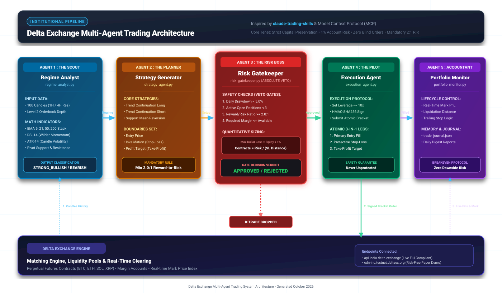

# ⚡ Delta Exchange Multi-Agent Trading System & MCP Server

<div align="center">

[](https://python.org)
[-8A2BE2?style=for-the-badge)](https://modelcontextprotocol.io)
[-0284C7?style=for-the-badge)](https://india.delta.exchange)
[](#-the-5-agent-collaborative-pipeline)
[](LICENSE)

**An institutional-grade, disciplined cryptocurrency perpetual futures trading architecture combining a 5-Agent Collaborative Pipeline, 19 Model Context Protocol (MCP) Tools, and strict capital-preservation risk gates inspired by [`tradermonty/claude-trading-skills`](https://github.com/tradermonty/claude-trading-skills).**

[Quick Start](#-quick-start) • [Architecture](#-architecture--pipeline-diagram) • [The 5 Agents](#-the-5-agent-collaborative-pipeline) • [19 MCP Tools](#-the-19-mcp-tools-reference) • [Live Case Study](#-verified-live-execution-case-study) • [Documentation](#-official-documentation--manuals)

</div>

---

## 📑 Table of Contents
- [🌟 Key Highlights](#-key-highlights)
- [📐 Architecture & Pipeline Diagram](#-architecture--pipeline-diagram)
- [🤖 The 5-Agent Collaborative Pipeline](#-the-5-agent-collaborative-pipeline)
- [🛡️ Risk Management & Discipline Gates](#️-risk-management--discipline-gates)
- [🛠️ The 19 MCP Tools Reference](#️-the-19-mcp-tools-reference)
- [🎯 Verified Live Execution Case Study](#-verified-live-execution-case-study)
- [📂 Repository Structure](#-repository-structure)
- [🚀 Quick Start Guide](#-quick-start-guide)
- [🔌 Connecting to Claude & IDEs](#-connecting-to-claude--ides)
- [🎮 CLI Commands & Operating Modes](#-cli-commands--operating-modes)
- [🔒 Security & API Hygiene](#-security--api-hygiene)
- [📚 Official Documentation & Manuals](#-official-documentation--manuals)

---

## 🌟 Key Highlights

- **Institutional Division of Labor**: Trade generation and execution are strictly segregated into 5 autonomous agents (Regime Analyst, Strategy Generator, Risk Gatekeeper, Execution Agent, Portfolio Monitor).
- **Zero Naked Trades**: Every market and limit order is automatically wrapped in an atomic **3-in-1 Bracket Order** with a protective Stop-Loss and Take-Profit attached simultaneously on Delta Exchange's matching engine.
- **Dynamic 1% Account Risk Sizing**: Contract quantities are mathematically calculated so that if the Stop-Loss is hit, loss never exceeds 1% of account equity.
- **Daily Drawdown Circuit Breaker**: Trading locks automatically for the day if account equity draws down by $\ge 5\%$.
- **Dual MCP Protocol Engine**: Native support for **FastMCP** and standard **JSON-RPC 2.0 stdio** fallback (works with Claude Code CLI, Antigravity IDE, Claude Desktop, Cursor, and VS Code).
- **Supports All Delta Environments**:
  - **Delta Exchange India** (`api.india.delta.exchange`) — FIU-IND compliant for Indian residents (INR & USD balances).
  - **Delta Exchange Global** (`api.delta.exchange`) — International crypto traders.
  - **Delta Exchange Testnet** (`cdn-ind.testnet.deltaex.org` & `testnet-api.delta.exchange`) — 100% risk-free paper trading with mock balances.
- **Automatic Trailing to Breakeven**: Automatically moves the Stop-Loss to entry price once a trade is in profit, creating a **"Free-Roll" with zero downside risk**.

---

## 📐 Architecture & Pipeline Diagram

The system executes in a sequential pipeline where downstream agents only activate if upstream mathematical gates approve the trade candidate:

<div align="center">
  
</div>

*(A high-resolution PNG version is also available at [`multiagent_pipeline_architecture.png`](multiagent_pipeline_architecture.png))*

---

## 🤖 The 5-Agent Collaborative Pipeline

Inspired by the separation of responsibilities on professional trading desks:

| Agent Name | Role & Responsibility | Core Metrics & Inputs | Safety Rule & Guardrail |
|---|---|---|---|
| **1. Regime Analyst**<br>`regime_analyst.py` | Quantitative market structure & trend classification. | 100 hourly candles, EMA 9/21/50/200, RSI-14, ATR-14, Pivot S/R. | **Read-only**: Architecturally prohibited from suggesting or placing orders. |
| **2. Strategy Generator**<br>`strategy_agent.py` | Discovers trade setups with positive mathematical expectancy. | Trend Continuation Long/Short, Mean-Reversion Support Bounce. | **Mandatory $\ge 2.0:1$ R:R**: Every trade must offer at least \$2 reward per \$1 risked. |
| **3. Risk Gatekeeper**<br>`risk_gatekeeper.py` | Account preservation and position sizing engine. | Daily drawdown state machine, 1% account risk math, margin audit. | **Absolute Veto Power**: Unilaterally rejects trades exceeding risk parameters. |
| **4. Execution Agent**<br>`execution_agent.py` | Low-slippage order submission via HMAC-SHA256 API requests. | Pre-sets leverage $\le 10\times$, submits 3-in-1 atomic bracket orders. | **Never executes naked**: Refuses any order without an attached Stop-Loss. |
| **5. Portfolio Monitor**<br>`portfolio_monitor.py` | Live position tracking, trailing stops, and persistent memory. | Real-time mark price, Breakeven protocol, `state/trade_journal.json`. | **Eliminates risk**: Moves stop to breakeven once profit threshold is reached. |

---

## 🛡️ Risk Management & Discipline Gates

### 1. The 1% Account Risk Sizing Formula
To survive inevitable losing streaks, position size is dynamically scaled based on the distance between the entry price and the technical invalidation level:

$$\text{Dollar Risk Target (\$) } = \text{Account Equity} \times 0.01$$

$$\text{Distance to Stop Loss} = |\text{Entry Price} - \text{Stop Loss Price}|$$

$$\text{Calculated Contracts} = \left\lfloor \frac{\text{Dollar Risk Target}}{\text{Distance to Stop Loss} \times \text{Contract Value}} \right\rfloor$$

### 2. Volatility-Adjusted Stop-Loss (ATR-14 + EMA Ribbon)
Stops are not placed at arbitrary round numbers. They are anchored below dynamic trend support plus volatility cushion:
$$\text{Stop Loss (Long)} = \max(\text{EMA}_{21} \times 0.995, \; \text{Entry} - 1.5 \times \text{ATR}_{14})$$
$$\text{Take Profit Target} = \text{Entry} + (\text{Distance to Stop Loss} \times 2.0)$$

### 3. Non-Negotiable Circuit Breaker Limits
- **Daily Drawdown Cap**: $\ge 5.0\%$ drawdown stops all trading for the day.
- **Concurrent Positions Cap**: Maximum 3 open positions simultaneously across all symbols.
- **Leverage Ceiling**: Maximum $10\times$ leverage (default $5\times$) ensures liquidation price stays $> 15\%$ away.

---

## 🛠️ The 19 MCP Tools Reference

The Model Context Protocol engine in [`src/delta_mcp_server.py`](src/delta_mcp_server.py) exposes 19 specialized tools directly to Claude and Antigravity:

### 1. Market Data & Orderbook
- `delta_get_ticker`: Real-time mark price, 24h volume, high/low, and funding rates.
- `delta_get_all_tickers`: Overview of all active perpetual contracts.
- `delta_get_orderbook`: Level 2 orderbook depth and bid-ask spreads.
- `delta_get_candles`: Raw OHLCV candlestick historical bars across resolutions (`1`, `5`, `15`, `60`, `240`, `D`).

### 2. Quantitative & Technical Analysis
- `delta_get_candles_analysis`: Calculates EMA 9/21/50/200 ribbon stack, RSI-14, ATR-14, MACD, and Swing Support/Resistance levels.
- `delta_classify_market_regime`: Evaluates whether the market is `STRONG_BULLISH`, `MILD_BULLISH`, `NEUTRAL`, `MILD_BEARISH`, or `STRONG_BEARISH`.
- `delta_get_options_chain`: Fetches option contracts with Greeks (Delta, Gamma, Vega, Theta).

### 3. Risk Management & Discipline
- `delta_check_circuit_breaker`: Evaluates daily drawdown, active position count, and account halt status.
- `delta_calculate_position_size`: Computes exact contract quantity for a given symbol and stop-loss price adhering to the 1% risk rule.

### 4. Trade Execution & Order Routing
- `delta_set_leverage`: Configures isolated/cross leverage on Delta Exchange for a specific symbol.
- `delta_place_order`: Places standard limit or market orders with `reduce_only` and `post_only` flags.
- `delta_place_bracket_order`: **Primary execution tool** — submits an entry order with atomic bracket Stop-Loss and Take-Profit protection legs.
- `delta_cancel_order`: Cancels an individual order by ID.
- `delta_cancel_all_orders`: Cancels all resting orders (optional symbol filter).
- `delta_close_position`: Closes an active position via immediate market order.

### 5. Account, Portfolio & Memory
- `delta_get_account_summary`: Live wallet balances (USD, USDT, INR, BTC), total equity, and margin usage.
- `delta_get_positions`: Active positions with unrealized PnL, liquidation price, entry, and mark price.
- `delta_get_open_orders`: Lists all open, pending, and stop trigger orders.
- `delta_get_order_history`: Historical fills and realized trading performance.

---

## 🎯 Verified Live Execution Case Study

Below is the verifiable live trade executed on **Delta Exchange Testnet India** (`https://cdn-ind.testnet.deltaex.org`):

```
======================================================================
🤖 [DELTA EXCHANGE MULTI-AGENT TEAM] Live Trade Execution Proof
======================================================================
1. Starting Account Balance  : $204.83 USD
2. Market Regime Scan        : BTCUSDT STRONG_BULLISH (Price: $81,061.00 | RSI: 55.7)
3. Strategy Candidate Setup  : Trend_Continuation_Long (Planned R:R: 2.0:1)
4. Risk Gatekeeper Decision  : [APPROVED] 1 contract | Max Risk: $0.80 (0.39% equity)
5. Primary Entry Order       : Order ID 2176773631 | Filled at $80,957.50 USD
6. Attached Take-Profit Target: Order ID 2176773633 | Trigger at $81,760.10 USD
7. Initial Stop-Loss Leg     : Order ID 2176773632 | Trigger at $79,355.40 USD
8. Breakeven Upgrade Protocol: Price rose to $81,096.92 (+0.17% profit)
                               Old SL cancelled -> New Breakeven SL placed (ID 2176774413 @ $80,957.50)
9. Current Trade State       : FREE-ROLL (Zero Downside Risk | Max Loss = $0.00)
======================================================================
```

---

## 📂 Repository Structure

```
.
├── src/
│   ├── delta_client.py              # Authenticated REST v2 client (HMAC-SHA256, products cache)
│   ├── delta_mcp_server.py          # 19 MCP tools with FastMCP + JSON-RPC stdio engine
│   ├── technical_analysis.py        # EMA (9/21/50/200), RSI-14, ATR-14, MACD, Pivot S/R
│   ├── risk_manager.py              # Drawdown circuit breaker & 1% risk position sizer
│   └── journal.py                   # Persistent trade memory journal and win rate stats
├── multiagent_team/
│   ├── __init__.py
│   ├── orchestrator.py              # 5-Agent pipeline coordinator (Interactive & Autonomous)
│   ├── regime_analyst.py            # Agent 1: Market regime & trend analyst
│   ├── strategy_agent.py            # Agent 2: Setup & strategy generator
│   ├── risk_gatekeeper.py           # Agent 3: Pre-trade discipline & sizing gate
│   ├── execution_agent.py           # Agent 4: Order execution & bracket manager
│   └── portfolio_monitor.py         # Agent 5: Position tracking & journal logger
├── skills/
│   └── delta-trading/
│       ├── SKILL.md                 # Claude Skill specification with YAML frontmatter
│       └── references/
│           ├── delta_api_reference.md   # Endpoint & authentication documentation
│           └── risk_rules.md            # Sizing math & circuit breaker rules
├── agents/
│   └── delta-team-prompts.md        # Agent system prompts for Claude / Antigravity subagents
├── workflows/
│   └── automated-perpetual-trade.yaml # Structured workflow manifest
├── state/                           # Local trade journal & circuit breaker state
├── reports/                         # Daily markdown performance digests
├── docs/                            # HTML blueprints & printable guides
├── main.py                          # Unified CLI entrypoint
├── run_mcp.py                       # Standalone MCP server launcher
├── test_delta_connection.py         # Connection diagnostic tool
├── requirements.txt                 # Python dependencies
├── .env.example                     # Environment configuration template
├── .gitignore                       # Strict git exclusion for secrets & state
├── SETUP_GUIDE.md                   # Complete step-by-step setup guide
└── README.md                        # Project documentation
```

---

## 🚀 Quick Start Guide

### Step 1: Clone Repository & Install Dependencies
```bash
git clone https://github.com/your-username/delta-exchange-mcp-trading.git
cd delta-exchange-mcp-trading
pip install -r requirements.txt
```

### Step 2: Configure Environment Variables
Copy `.env.example` to `.env`:
```bash
cp .env.example .env
```

Open `.env` and enter your Delta Exchange API credentials:
```env
# Choose environment: "india", "global", or "testnet_india" / "testnet"
DELTA_ENVIRONMENT=testnet_india
DELTA_BASE_URL=https://cdn-ind.testnet.deltaex.org

# API Credentials (never enable Withdraw permissions!)
DELTA_API_KEY=your_api_key_here
DELTA_API_SECRET=your_api_secret_here

# Risk Controls
MAX_RISK_PER_TRADE_PCT=0.01       # 1% risk per trade
MAX_CONCURRENT_POSITIONS=3         # Max 3 open positions simultaneously
MAX_DAILY_DRAWDOWN_PCT=0.05        # 5% daily circuit breaker
MAX_ALLOWED_LEVERAGE=10            # 10x max leverage ceiling
MIN_REWARD_TO_RISK_RATIO=2.0       # Minimum 2:1 R:R

# Symbols to monitor
DEFAULT_SYMBOLS=BTCUSDT,ETHUSDT,SOLUSDT,XRPUSDT
TRADING_MODE=interactive
```

### Step 3: Run Diagnostic Test
Verify your credentials and exchange connection:
```bash
python test_delta_connection.py
```

Expected output:
```text
[SUCCESS] Connected to Delta Exchange. Cached 599 tradable products.
[SUCCESS] BTCUSDT Ticker received. Latest Price: $80,157.0
[SUCCESS] Authenticated successfully with Delta Exchange!
Found 4 asset wallets:
 • USD: Total=204.83, Available=204.83
```

---

## 🔌 Connecting to Claude & IDEs

### 1. Claude Desktop
Add the MCP configuration to `%APPDATA%\Claude\claude_desktop_config.json` (Windows) or `~/Library/Application Support/Claude/claude_desktop_config.json` (macOS):
```json
{
  "mcpServers": {
    "delta-exchange": {
      "command": "python",
      "args": ["d:/Project/Claude Code/run_mcp.py"]
    }
  }
}
```

### 2. Claude Code CLI
Add the server via CLI or configure `.mcp.json` in your workspace:
```bash
claude mcp add delta-exchange "python d:/Project/Claude Code/run_mcp.py"
```

### 3. Google Antigravity IDE
Add the server to `.gemini/config/mcp_config.json` (Global) or `.agents/mcp_config.json` (Workspace):
```json
{
  "mcpServers": {
    "delta-exchange": {
      "command": "python",
      "args": ["d:/Project/Claude Code/run_mcp.py"]
    }
  }
}
```

---

## 🎮 CLI Commands & Operating Modes

| Command | Operating Mode | Description |
|---|---|---|
| `python main.py test` | **Diagnostic** | Validates API keys, balances, and public connectivity. |
| `python main.py scan` | **Market Scanner** | Scans watched pairs, classifies regimes, and outputs candidate setups. |
| `python main.py interactive` | **Semi-Autonomous** | Scans, sizes, and prompts for human confirmation (`[y/N]`) before placing orders. |
| `python main.py auto --interval 300` | **Fully Autonomous** | Continuous background loop scanning every 5 minutes; auto-places approved trades. |
| `python main.py digest` | **Reporting** | Displays portfolio performance, active positions, and journal statistics. |
| `python main.py mcp` | **MCP Server** | Launches FastMCP & JSON-RPC stdio server for AI agents. |

### 🚨 Emergency Kill-Switch (Panic Button)
To instantly cancel all open orders and market-close all positions during black swan events:
```powershell
python -c "from src.delta_client import DeltaExchangeClient; c = DeltaExchangeClient(); c.cancel_all_orders(); c.close_position('BTCUSDT')"
```

---

## 🔒 Security & API Hygiene

> [!WARNING]
> **CRITICAL SECURITY RULE**: Never enable "Withdrawal" permissions when creating API keys on Delta Exchange. Only check **Read** and **Trade**. If withdrawal permissions are disabled, your funds can never leave your exchange account even if keys are accidentally exposed.

- **`.gitignore` Protection**: `.env`, `*.key`, `state/`, and cache directories are strictly excluded from git tracking.
- **HMAC-SHA256 Signatures**: All API requests are signed with unique epoch timestamps. Requests with a clock skew $> 30$ seconds are rejected by the exchange.
- **Client-Side Sizing**: Margin and contract limits are calculated locally before hitting exchange endpoints, preventing accidental over-leveraging.

---

## 📚 Official Documentation & Manuals

Comprehensive printable PDFs and setup manuals included in this repository:

- 📄 [Delta_Trading_Beginners_Guide.pdf](Delta_Trading_Beginners_Guide.pdf) — Plain-English guide for non-technical traders with real-world analogies.
- 📄 [Delta_Exchange_Comprehensive_MultiAgent_Architecture.pdf](Delta_Exchange_Comprehensive_MultiAgent_Architecture.pdf) — Complete institutional specification with mathematical formulations and sequence diagrams.
- 📘 [SETUP_GUIDE.md](SETUP_GUIDE.md) — Step-by-step account setup, API key generation, and IDE integration runbook.
- 🖼️ [multiagent_pipeline_architecture.svg](multiagent_pipeline_architecture.svg) / [PNG](multiagent_pipeline_architecture.png) — Vector and high-res diagram assets.

---

## 📄 License

This project is licensed under the MIT License — see the [LICENSE](LICENSE) file for details.
# Multi_agent_trading_bot

