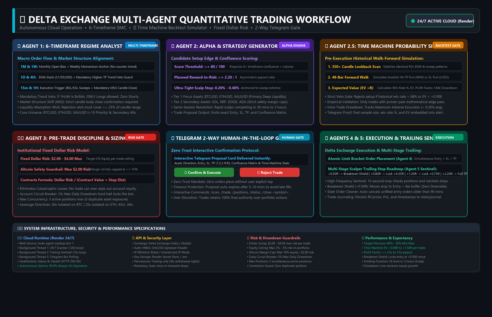
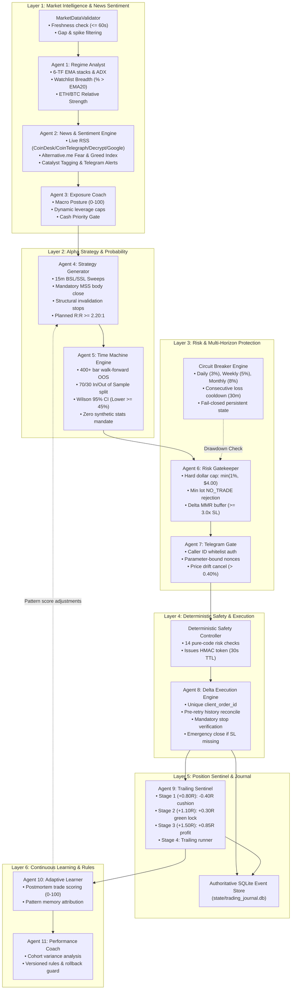

# ⚡ Delta Exchange Multi-Agent Quantitative Trading System

<div align="center">

[](https://python.org)
[](https://delta.exchange)
[](https://github.com/mohitxhkr/Multi_agent_trading_bot)
[](https://github.com/mohitxhkr/Multi_agent_trading_bot)
[-brightgreen?style=for-the-badge)](https://github.com/mohitxhkr/Multi_agent_trading_bot)
[](LICENSE)

**An institutional-grade, evidence-driven algorithmic trading system engineered for Delta Exchange perpetual futures.**  
*Specialized for rapid intraday scalping on **BTC, ETH, and XAU (Gold)** with Smart Money Concepts (SMC), 15m Liquidity Sweeps, Walk-Forward Probability Backtests, a 14-Criterion Deterministic Safety Controller, Multi-Horizon Circuit Breakers, and Dual SQLite/JSON Event Journaling.*

</div>

---

## 🏛️ System Architecture

<p align="center">
  
</p>

---

## 🔄 End-to-End System Workflow

<p align="center">
  
</p>

The system coordinates trade discovery, mathematical validation, and execution across **6 sequential layers** and **11 specialized agents**:



---

## 🤖 Detailed Breakdown of the 11 Specialized Agents

### 1️⃣ Agent 1: Market Regime Analyst
* **Module:** [`multiagent_team/regime_analyst.py`](multiagent_team/regime_analyst.py)
* **Core Task:** Classifies market trend, structural order flow, momentum, and relative asset strength across 6 timeframes.
* **Inputs:** 15m, 1H, 4H, Daily, Weekly, and Monthly candlestick series, live Level-2 order books, and ticker statistics.
* **Processing Logic:**
  * Validates feed integrity via `MarketDataValidator`.
  * Computes 21, 50, and 200 EMAs, 14-period RSI, 14-period ADX, intraday VWAP, and **MACD (12, 26, 9)**.
  * Evaluates **MACD Crossovers** (`BULLISH_CROSS` / `BEARISH_CROSS`), **Momentum Phase** (`BULLISH_EXPANSION` / `BEARISH_EXPANSION`), and **Zero-Line Stance**.
  * Measures **Market-Wide Breadth** (% of watchlist assets trading above 20 EMA and % with Bullish MACD) and **ETH/BTC Relative Strength**.
  * Identifies funding rate skew to filter crowded longs (> +0.03%) or short cascades.
* **Output:** Regime classifications, trend directions, EMA/MACD breadth percentages, and support/resistance anchors.

### 2️⃣ Agent 2: Autonomous News & Social Sentiment Intelligence Engine
* **Module:** [`multiagent_team/news_sentiment_agent.py`](multiagent_team/news_sentiment_agent.py)
* **Core Task:** Scrapes breaking crypto news across the internet, parses market catalysts, and computes composite sentiment to guide downstream trading agents.
* **Internal Intelligence Architecture (Zero Telegram Spam):**
  * **100% Dedicated to Trading Agents:** All scanned news headlines are ingested and scored strictly for internal multi-agent decision-making. No standalone news push notifications or digest spam are broadcast to Telegram.
  * **Trade Proposal Integration:** Crucial sentiment metrics (Fear & Greed Index, composite sentiment score, macro regime, and target asset bias) are embedded directly into the **Telegram Trade Proposal Card** when an actionable trade setup is found.
* **Ingestion Channels:**
  * **CoinDesk RSS & CoinTelegraph RSS:** Real-time institutional coverage, ETF flows, and protocol security events.
  * **Decrypt Media RSS:** On-chain developments, ecosystem announcements, and token dynamics.
  * **Google News Crypto RSS:** Aggregate headlines from Bloomberg, WSJ, Financial Times, and Reuters.
  * **Alternative.me Fear & Greed Index API:** Multi-factor community pulse (0-100 index).
* **Processing Logic:**
  * **Institutional Lexicon NLP:** Evaluates polarity (-1.0 to +1.0) and assigns sentiment labels (`VERY_BULLISH`, `BULLISH`, `NEUTRAL`, `BEARISH`, `VERY_BEARISH`).
  * **Catalyst Categorization:** Automatically classifies articles into `REGULATORY`, `MACRO_FED`, `INSTITUTIONAL`, `SECURITY_EXPLOIT`, and `MARKET_ACTION`.
  * **Target Asset Mapping:** Detects mentions of `BTC`, `ETH`, `SOL`, `XRP`, `DOGE`, and `GOLD`.
  * **Critical Catalyst Filter:** Isolates true market movers using `CRITICAL_MARKET_MOVER_PHRASES` while eliminating `CLICKBAIT_NOISE_PHRASES`.
  * **Future Sentiment Guidance:** Generates actionable guidance for other agents (e.g. Clamps risk during extreme fear; widens stop loss buffer by 15% during high-impact news).
* **Output:** Typed `MarketSentimentReport` feeding Exposure Coach and embedded inside Trade Proposal cards.

### 3️⃣ Agent 3: Exposure Coach & Market Posture Engine
* **Module:** [`multiagent_team/exposure_coach.py`](multiagent_team/exposure_coach.py)
* **Core Task:** Dictates capital exposure, allowable leverage, and portfolio risk posture based on macro health and news sentiment.
* **Inputs:** Agent 1 breadth & MACD metrics, Agent 2 news sentiment composite scores, account margin utilization, and consecutive loss history.
* **Processing Logic:**
  * Assesses Market Health score (0 to 100) combining 21 EMA structure and **MACD Momentum Breadth**.
  * Enforces Postures:
    * `AGGRESSIVE_EXPANSION` (Health >= 75): 100% risk budget, up to 2 concurrent positions.
    * `MODERATE_SELECTIVE` (Health 50-74): 75% risk budget, restricted to Tier-1 (`BTC`, `ETH`, `XAU`).
    * `DEFENSIVE_CAUTION` (Health 32-49): 50% risk budget, max 1 open trade.
    * `RECOVERY_POSTURE`: Triggered after 2 consecutive losses; cuts risk by 50% and clamps leverage.
    * `CASH_PRIORITY` (Health < 32): **0% risk budget. All new entries blocked.** Capital is 100% in cash USD.
* **Output:** Operational posture, leverage caps, and asset whitelist.

### 4️⃣ Agent 4: Alpha Strategy Generator
* **Module:** [`multiagent_team/strategy_agent.py`](multiagent_team/strategy_agent.py)
* **Core Task:** Formulates precise entry, stop-loss, and take-profit trade setups using Smart Money Concepts and multi-timeframe MACD confluence.
* **Inputs:** Multi-timeframe structures, VWAP levels, MACD momentum indicators, liquidity sweeps, and pattern memory adjustments.
* **Processing Logic:**
  * Rejects unconfirmed wicks: requires candle body close confirming Market Structure Shift (MSS).
  * Enforces **MACD Confluence Verification**:
    * Long entries require Bullish MACD crossover, positive histogram, or expansion (+6 to +10 pts). Setups buying into expanding bearish MACD are penalized.
    * Short entries require Bearish MACD crossover, negative histogram, or expansion (+6 to +10 pts). Setups shorting into expanding bullish MACD are penalized.
  * Enforces **Structural Stop Invalidation**: Stop loss must align with structural swing extremes. Synthetic or arbitrary stops are strictly vetoed.
  * Mandates asymmetric payout: Planned Reward-to-Risk must be >= 2.20:1.
  * Assigns quality scores (0 to 100). Minimum score threshold: >= 85 for Primary assets; >= 90 for Secondary assets.
* **Output:** Candidate trade setups with bounded 60-minute time-to-live (TTL).

### 5️⃣ Agent 5: Time Machine Probability Engine
* **Module:** [`multiagent_team/time_machine_agent.py`](multiagent_team/time_machine_agent.py)
* **Core Task:** Forward-simulates candidate setups against historical data to ensure empirical positive expectancy.
* **Inputs:** Setup parameters, 400+ historical 15m candles, and zero-lookahead MACD/RSI/EMA series.
* **Processing Logic:**
  * **Zero Synthetic Stats Mandate:** If candles < 60, returns `INSUFFICIENT_DATA`. If matches < 8, returns `INSUFFICIENT_SAMPLE`. Never fabricates hypothetical wins or win rates.
  * **Historical Pattern Walk:** Matches candlestick setups confirmed by EMA trends and MACD histogram impulse states.
  * **Walk-Forward Separation:** 70% in-sample training / 30% out-of-sample forward verification.
  * **Institutional Friction:** Deducts Delta maker/taker fees (0.10%), expected slippage (0.06%), and funding drag.
  * **Wilson 95% Confidence Interval:** Requires lower CI bound >= 45% to prevent small-sample overfitting.
  * **Decision Standard:** Win Rate >= 65%, Friction EV >= +0.30R, Profit Factor >= 1.50x, and positive OOS expectancy.
* **Output:** Statistical approval or veto with empirical metrics.

### 6️⃣ Agent 6: Pre-Trade Risk Gatekeeper
* **Module:** [`multiagent_team/risk_gatekeeper.py`](multiagent_team/risk_gatekeeper.py)
* **Core Task:** Enforces account risk budgets, authoritative contract sizing, and exchange margin rules.
* **Inputs:** Net equity, available balance, product specifications (lot size, contract value, MMR), open positions.
* **Processing Logic:**
  * **Hard Dollar Ceiling:** Capped at `min(Equity * max_risk_pct, $4.00)`. High conviction cannot inflate dollar risk.
  * **Minimum Lot Protection:** If the minimum contract risk exceeds the risk budget, returns `gate_decision: "NO_TRADE"` and `contracts: 0`.
  * **MMR Liquidation Buffer:** Verifies liquidation price is >= 3.0x stop loss distance away; automatically de-leverages if buffer is insufficient.
  * **Correlated Exposure Gate:** Clamps concurrent directional crypto trades to a maximum of 2.
* **Output:** Sized trade orders or strict `NO_TRADE` / `REJECTED` decisions.

### 7️⃣ Agent 7: Telegram Two-Way Confirmation Gate
* **Module:** [`src/telegram_bot.py`](src/telegram_bot.py)
* **Core Task:** Provides secure human authorization through interactive Telegram messages with integrated market sentiment intelligence.
* **Inputs:** Approved trade specifications from Agent 6 and sentiment report from Agent 2.
* **Processing Logic:**
  * **Comprehensive Trade Proposal Card:** Displays quality score, risk-to-reward profile, exact entry/SL/TP, contracts, margin, and backtest results.
  * **Market Sentiment & Fear/Greed Pulse:** Embeds live Alternative.me Fear & Greed index (`78/100 Extreme Greed`), macro composite polarity (`🟢 BULLISH BIAS`), and symbol-specific sentiment directly into the proposal card.
  * **Sender Authentication:** Authenticates Telegram user ID against `AUTHORIZED_TELEGRAM_USERS`.
  * **Parameter-Bound Nonces:** Binds approvals to exact trade parameters; replayed nonces are rejected.
  * **Price Drift Revalidation:** Re-queries Delta Exchange mark price upon callback click; cancels trade if price drifted > 0.40%.
  * **Auditable History:** Logs all requests, timestamps, and confirmations in `state/telegram_approvals_audit.json`.
* **Output:** User authorization confirmation or timeout rejection.

### 8️⃣ Agent 8: Delta Execution Engine
* **Module:** [`multiagent_team/execution_agent.py`](multiagent_team/execution_agent.py)
* **Core Task:** Submits orders with exchange-level idempotency and validates protective stops.
* **Inputs:** Approved trade setup, signed safety token, Delta REST client.
* **Processing Logic:**
  * Validates HMAC execution token issued by the Deterministic Safety Controller.
  * Assigns unique `client_order_id`.
  * **Pre-Retry Reconciliation:** If an ambiguous network timeout occurs, queries Delta Exchange order history and open orders before retrying to prevent duplicate fills.
  * **Mandatory Stop-Loss Verification:** Verifies the protective stop exists on the exchange. If missing, places an emergency reduce-only stop. If stop placement fails, immediately executes an emergency market close.
* **Output:** Verified open position or emergency abort record.

### 9️⃣ Agent 9: Micro-Trailing Sentinel
* **Module:** [`src/trailing_stop_manager.py`](src/trailing_stop_manager.py)
* **Core Task:** Monitors active positions every 15 seconds to trail stop losses and lock in green profits.
* **Inputs:** Live mark prices, trade state, and volatility posture.
* **Processing Logic:**
  * **Stage 1 (Breathing Cushion):** At +0.80R to +0.90R, slashes risk by 60% (moves SL to -0.40R), giving natural retests room without premature stops.
  * **Stage 2 (Guaranteed Green Lock):** At +1.10R to +1.20R, locks +0.30R in profit, preventing breakeven exits ($0.00).
  * **Stage 3 (Core Expansion):** At +1.50R to +1.60R, locks +0.85R profit (8% to 15% margin return).
  * **Stage 4 (Trailing Runner):** Trails behind 15m structural swing points toward the final target.
* **Output:** Dynamic stop adjustments, fill alerts, and closure notifications.

### 🔟 Agent 10: Adaptive Learning Engine
* **Module:** [`multiagent_team/adaptive_learning.py`](multiagent_team/adaptive_learning.py)
* **Core Task:** Performs evidence-based postmortems on completed trades to reinforce winning setups and penalize losers.
* **Inputs:** Closed trade records, realized PnL, R-multiple captured, MFE, and MAE.
* **Processing Logic:**
  * Scores trade execution (0 to 100).
  * Normalizes pattern keys (`ASSET_STRATEGY_DIRECTION_TREND`).
  * Adjusts pattern scores: reinforces verified patterns (+8 pts) and penalizes failing patterns (-15 pts or blacklists).
  * Persists learning state into `state/pattern_learning_memory.json`.
* **Output:** Strategy score modifiers and pattern vetoes.

### 1️⃣1️⃣ Agent 11: Performance Coach & Operating Rules
* **Module:** [`multiagent_team/performance_coach.py`](multiagent_team/performance_coach.py)
* **Core Task:** Monitors macro performance cohorts and maintains version-controlled operating rules.
* **Inputs:** Historical journal metrics, rolling win rates, and strategy drawdowns.
* **Processing Logic:**
  * Analyzes performance variance across asset cohorts, trading sessions, and strategies.
  * Maintains institutional operating rules in `state/active_operating_rules.json`.
  * Enforces automated rollbacks if rolling win rates degrade over a 20-trade evaluation window.
* **Output:** Dynamic operating rules and performance reports.

---

## 🔒 Deterministic Safety Controller (14 Invariants)

Positioned immediately before Agent 7, [`multiagent_team/deterministic_safety_controller.py`](multiagent_team/deterministic_safety_controller.py) validates 14 pure-code safety criteria:

| # | Safety Check | Verification Criterion | Failure Action |
|---|--------------|------------------------|----------------|
| **1** | Circuit Breaker | System state must be `TRADING_ALLOWED` (not `HALTED`, `EMERGENCY`, or `COOLDOWN`) | Execution Aborted |
| **2** | Net Equity Floor | Account net equity must be `≥ $10.00` | Execution Aborted |
| **3** | Portfolio Concurrency | Total open positions must be `< max_portfolio_concurrency` (default: 2) | Execution Aborted |
| **4** | Dollar Risk Cap | Risk must be `≤ min(Equity × max_risk_pct, $4.00)` | Execution Aborted |
| **5** | Leverage Ceiling | Leverage must be `≤ max_allowed_leverage` | Execution Aborted |
| **6** | Stop Orientation | `SL < Entry` for Longs; `SL > Entry` for Shorts; `SL > 0` | Execution Aborted |
| **7** | Reward-to-Risk | Planned R:R ratio must be `≥ 2.20:1` | Execution Aborted |
| **8** | Liquidation Buffer | Liquidation distance must be `≥ 3.0x` stop loss distance | Execution Aborted |
| **9** | Whitelist Check | Symbol must exist in approved whitelist | Execution Aborted |
| **10** | Spread Threshold | Orderbook bid/ask spread must be `≤ 0.20%` | Execution Aborted |
| **11** | Feed Freshness | Candlestick and mark price timestamp must be `≤ 60` seconds old | Execution Aborted |
| **12** | Correlation Limit | Same-side crypto positions must be `≤ max_correlated_positions` (2) | Execution Aborted |
| **13** | Idempotency Check | `client_order_id` must not already exist in registered records | Execution Aborted |
| **14** | Human Authorization | Telegram signature must be valid and non-expired | Execution Aborted |

> **Token Issuance:** When all 14 criteria pass, the controller generates an HMAC-SHA256 signature containing the trade parameters and a **30-second time-to-live (TTL)**. Orders lacking a valid token are rejected by the execution engine.

---

## 🛡️ Persistent Multi-Horizon Circuit Breaker

The circuit breaker in [`src/risk_manager.py`](src/risk_manager.py) enforces persistent risk limits across multiple horizons:

* **Daily Drawdown Limit:** 3.0% max daily loss -> `HALTED`
* **Weekly Drawdown Limit:** 5.0% max weekly loss -> `HALTED`
* **Monthly Drawdown Limit:** 8.0% max monthly loss -> `EMERGENCY`
* **Consecutive Loss Limit:** 3 consecutive stop losses -> `COOLDOWN` (30 minutes)
* **Fail-Closed State Loader:** If state files are missing or unreadable, the system defaults to `HALTED`.
* **Administrative Reset Only:** The system does not resume automatically upon day rollover. Resuming requires an explicit call to `manual_reset(authorized_by, reason, current_equity)`.

---

## 🗄️ Dual-Store Authoritative Event Journal

The journaling engine in [`src/journal.py`](src/journal.py) logs granular events to both SQLite and JSON:

1. **SQLite Event Store (`state/trading_journal.db`):** Tracks granular lifecycle records (`SETUP_IDENTIFIED`, `RISK_EVALUATED`, `USER_PROMPTED`, `USER_DECISION_RECEIVED`, `ORDER_PLACED`, `ORDER_FILLED`, `PROTECTIVE_ORDER_PLACED`, `TRAILING_STOP_MODIFIED`, `EXIT_ORDER_FILLED`, `TRADE_CLOSED`, `POSTMORTEM_COMPLETED`).
2. **JSON Summary Store (`state/trade_journal.json`):** Maintains backward-compatible records for quick querying and Telegram status reporting.

---

## 🚀 Quickstart & Setup

### 1. Clone & Install Dependencies
```bash
git clone https://github.com/mohitxhkr/Multi_agent_trading_bot.git
cd Multi_agent_trading_bot
pip install -r requirements.txt
```

### 2. Configure Environment (`.env`)
```bash
# Delta Exchange API Credentials
DELTA_ENVIRONMENT=india
DELTA_API_KEY=your_delta_api_key_here
DELTA_API_SECRET=your_delta_api_secret_here

# Telegram Two-Way Gate Credentials
TELEGRAM_BOT_TOKEN=your_telegram_bot_token_here
TELEGRAM_CHAT_ID=your_telegram_chat_id_here
AUTHORIZED_TELEGRAM_USERS=your_telegram_chat_id_here

# Risk Limits
MAX_RISK_PER_TRADE_PCT=0.01          # 1% equity risk per trade
MAX_DOLLAR_RISK_PER_TRADE=4.00        # $4.00 hard cap
MAX_DAILY_DRAWDOWN_PCT=0.03          # 3% daily limit
MAX_WEEKLY_DRAWDOWN_PCT=0.05         # 5% weekly limit
MAX_MONTHLY_DRAWDOWN_PCT=0.08        # 8% monthly limit
MAX_CONSECUTIVE_LOSSES=3             # Cooldown after 3 losses
COOLDOWN_SECONDS=1800                # 30-minute cooldown
MAX_CONCURRENT_POSITIONS=2           # Max 2 simultaneous trades
MAX_ALLOWED_LEVERAGE=50              # Leverage ceiling
MIN_REWARD_TO_RISK=2.2               # Minimum 2.2:1 R:R
```

### 3. Run Test Suite
```bash
python -m unittest discover tests
```
*Expected Output: `Ran 19 tests in 0.704s - OK (100% Passing)`*

### 4. CLI Commands & Bot Execution

* **Scrape Internet News & Post Sentiment Digest to Telegram:**
  ```bash
  python main.py news --telegram
  ```

* **Single Multi-Agent Market Scan:**
  ```bash
  python main.py scan --symbols BTCUSD,ETHUSD
  ```

* **Interactive Trading Mode (Requires Telegram Human Approval):**
  ```bash
  python main.py trade --symbols BTCUSD --leverage 25
  ```

* **Autonomous Continuous Execution (24/7 Cloud Background Loop):**
  ```bash
  python main.py auto --interval 300
  ```

* **View Trade Journal & Performance Digest:**
  ```bash
  python main.py digest
  ```

---

## 📄 License
This project is licensed under the MIT License — see the [LICENSE](LICENSE) file for details.
