# ⚡ Delta Exchange Multi-Agent Quantitative Trading System

<div align="center">

[](https://python.org)
[](https://delta.exchange)
[](https://telegram.org)
[](https://render.com)
[](https://github.com/mohitxhkr/Multi_agent_trading_bot)
[](LICENSE)

**An institutional-grade, disciplined 10-Agent algorithmic trading system engineered for Delta Exchange perpetual futures.**  
*Specialized for Rapid Scalping on **BTC, ETH, and XAU (Gold)** with Smart Money Concepts (SMC), 15m Microstructure Sweeps, Ultra-Tight Stop Losses, 80–90% Precision Filters, Multi-Stage Scalper Trailing Stops (+0.50R BE), Continuous Self-Learning, and 24/7 Autonomous Cloud Operation.*

</div>

---

## 🏛️ System Architecture

<p align="center">
  <a href="https://raw.githubusercontent.com/mohitxhkr/Multi_agent_trading_bot/main/workflow_architecture_diagram.png" target="_blank">
    
  </a>
</p>

> **📥 Downloadable Architecture Assets:**  
> • **[Download High-Resolution PNG Architecture Diagram (2400 × 1550)](https://raw.githubusercontent.com/mohitxhkr/Multi_agent_trading_bot/main/workflow_architecture_diagram.png)**  
> • **[Download Scalable Vector (SVG Diagram)](workflow_architecture_diagram.svg)**  
> • **[Open Interactive HTML Architecture Viewer](workflow_architecture.html)**

---

## 🔄 End-to-End Scalper Workflow (Agents 1 to 10 in Execution Sequence)

```mermaid
flowchart TD
    subgraph Runtime ["☁️ 24/7 Cloud Autonomous Runtime (Render)"]
        Scanner["Continuous Silent Market Scanner (120s Loop)"]
    end

    subgraph MarketAnalysis ["🔍 Market Structure & Exposure Posture (Agents 1 & 2)"]
        A1["Agent 1: 6-Timeframe Regime Analyst<br/>• Trend Momentum: 1M, 1W, 1D, 4H, 1H, 15m<br/>• Mandatory Macro Trend Veto (No Counter-Trend)<br/>• SMC Liquidity Sweeps (BSL and SSL)"]
        A2["Agent 2: Exposure Coach & Market Posture<br/>• Market Breadth (% Above 21 EMA)<br/>• Composite Market Health Score (0-100)<br/>• Cash Priority Gate (Health below 32)"]
    end

    subgraph AlphaRisk ["🛡️ Alpha Generation, Simulation & Risk Gate (Agents 3, 4 & 5)"]
        A3["Agent 3: Alpha Strategy & Candidate Generator<br/>• Mandatory MSS Candle Body Close<br/>• OTE 0.382 Retest & Killzone Boost<br/>• Target 2.20:1+ R:R (Score 80+/100)"]
        A4["Agent 4: Time Machine Probability Engine<br/>• 350+ Candle Lookback Simulation<br/>• 48-Bar Forward Walkthrough (TP vs SL)<br/>• Strict Veto Gate: Discard if Win Rate below 68%"]
        A5["Agent 5: Pre-Trade Discipline & Dollar Sizing<br/>• Fixed Dollar Risk Model: $2.00 - $4.00 Max Risk<br/>• Altcoin Safety Cap: Max $2.00 Risk / 10% Margin<br/>• 2-Loss Cooling-Off Halt & 5% Daily Stop"]
    end

    subgraph HumanGate ["📱 Telegram Two-Way Human Authorization (Agent 6)"]
        A6["Agent 6: Telegram 2-Way Gate<br/>• Proposal Card with Confluence & Time Machine Proof<br/>• User Buttons: Confirm & Execute or Reject<br/>• Zero Orders Placed Without Explicit User Click"]
    end

    subgraph BrokerExecution ["⚡ Delta Exchange Order Execution (Agent 7)"]
        A7["Agent 7: Delta Exchange Execution Engine<br/>• HMAC-SHA256 Signed Authentication<br/>• Isolated Margin (50x BTC / 25x Alts)<br/>• Native 3-in-1 Atomic Limit Bracket (Entry + SL + TP)"]
    end

    subgraph TrailingSentinel ["🔒 Real Scalper Micro-Trailing Sentinel (Agent 8)"]
        A8["Agent 8: Micro-Trailing Stop Sentinel (15s Loop)<br/>• Stage 1 (+0.50R): Breakeven Shield (Zero Downside)<br/>• Stage 2 (+0.80R): Lock +0.35R Green Profit<br/>• Stage 3 (+1.20R): Lock +0.75R Core Profit<br/>• Stage 5 (+2.20R): Full TP Bracket Realized<br/>• MFE & MAE Excursion Tracking"]
    end

    subgraph LearningReview ["🧠 Continuous Evolution & Performance Coaching (Agents 9 & 10)"]
        A9["Agent 9: Adaptive Learning & Pattern Diagnosis<br/>• 0-100 Self-Scorecard (Discipline, Edge)<br/>• Reinforces Winning Patterns (+8 pts boost)<br/>• Penalizes or Blacklists Failing Setups"]
        A10["Agent 10: Trade Performance Coach<br/>• Closed Trade Cohort Audit<br/>• Synthesizes Binding Next-Session Rules (/rules)<br/>• Dynamically Governs Future Strategy & Risk"]
    end

    Scanner --> A1
    A1 --> A2
    A2 -->|Cash Priority: Health Under 32| CashHalt["🛑 100% Cash Defense (All Entries Blocked)"]
    A2 -->|Normal Market Posture| A3
    A3 --> A4
    A4 -->|Passed: Win Rate 68%+ & Positive EV| A5
    A4 -->|Failed: Historical Win Rate Under 68%| Vetoed["❌ Zero Risk (Low-Edge Setup Vetoed)"]
    A5 --> A6
    A6 -->|User Rejects or Proposal Times Out| Vetoed
    A6 -->|User Confirms via Button| A7
    A7 --> A8
    A8 -->|Position Closed| A9
    A9 --> A10
```



---

## 🤖 The 10 Autonomous Agents (Sequence 1 to 10)

The system divides trading responsibilities into **10 specialized autonomous agents**, operating in strict sequential lockstep:

```
[Agent 1: Regime Analyst]
       ↓
[Agent 2: Exposure Coach]
       ↓
[Agent 3: Strategy Generator]
       ↓
[Agent 4: Time Machine Engine]
       ↓
[Agent 5: Risk Gatekeeper]
       ↓
[Agent 6: Telegram Confirmation Gate]
       ↓
[Agent 7: Execution Engine]
       ↓
[Agent 8: Trailing Sentinel]
       ↓
[Agent 9: Adaptive Learner]
       ↓
[Agent 10: Performance Coach]
```

---

### 1️⃣ Agent 1: 6-Timeframe Regime Analyst
* **Module:** [`multiagent_team/regime_analyst.py`](multiagent_team/regime_analyst.py)
* **Execution Timing:** Start of every 120-second scan cycle.
* **Core Responsibilities:**
  1. **6-Timeframe Order Flow Mapping:** Ingests live candles across **1-Month (1M), 1-Week (1W), 1-Day (1D), 4-Hour (4H), 1-Hour (1H), and 15-Minute (15m)** timeframes.
  2. **Trend Momentum Stacks:** Computes exponential moving averages (EMA 21, EMA 50, EMA 200), RSI (14), and ATR across all horizons.
  3. **Smart Money Concepts (SMC) Liquidity Mapping:** Identifies Buy-Side Liquidity (BSL) and Sell-Side Liquidity (SSL) pools, prior day highs/lows (PDH/PDL), and session range sweeps.
  4. **The Mandatory Macro Trend Veto:**
     * If the 4H and 1H regime is **BULLISH**, the bot is **STRICTLY FORBIDDEN** from proposing shorts. Only long sweep pullbacks are qualified.
     * If the 4H and 1H regime is **BEARISH**, the bot is **STRICTLY FORBIDDEN** from proposing longs.
     * Counter-trend scalp attempts are vetoed at the root.

---

### 2️⃣ Agent 2: Exposure Coach & Market Posture Engine
* **Module:** [`multiagent_team/exposure_coach.py`](multiagent_team/exposure_coach.py)
* **Execution Timing:** Immediately following market scanning, before setup generation.
* **Core Responsibilities:**
  1. **Cross-Asset Participation Breadth:** Calculates the exact percentage of tracked universe assets trading above their 21 EMA.
  2. **Aggregate Derivatives Funding Sentiment:** Evaluates average Delta Exchange perpetual funding rates to gauge market froth or aggressive short crowding.
  3. **Market Health Score (0–100):** Synthesizes BTC macro order flow (35 pts), cross-asset breadth (45 pts), and funding alignment (20 pts).
  4. **Global Market Posture Classification:**
     * **`AGGRESSIVE_EXPANSION` (Health >= 75):** 100% risk budget, up to 3 concurrent positions permitted.
     * **`MODERATE_SELECTIVE` (Health 50-74):** 75% risk budget, focus on Tier-1 core assets (`BTC`, `ETH`, `XAU`).
     * **`DEFENSIVE_CAUTION` (Health 32-49):** 50% risk budget, max 1 active position, secondary alts completely disabled.
     * **`CASH_PRIORITY` (Health below 32):** **0% risk budget. All new entries blocked.** Capital is 100% safeguarded in cash USD.

---

### 3️⃣ Agent 3: Alpha Strategy & Candidate Generator
* **Module:** [`multiagent_team/strategy_agent.py`](multiagent_team/strategy_agent.py)
* **Execution Timing:** Triggered when Market Posture authorizes trading.
* **Core Responsibilities:**
  1. **Mandatory Market Structure Shift (MSS):** Rejects unconfirmed wicks. Requires a confirmed candle body close breaking prior swing structure.
  2. **Liquidity Absorption Wick Filter:** The sweep candle must demonstrate a rejection wick spanning at least 25% of its total high-to-low range.
  3. **Optimal Trade Entry (OTE) Retest Pricing:** If the expansion candle exceeds 1.0x ATR, places a limit entry order at the **0.382 Fibonacci retracement** rather than market chasing.
  4. **Institutional Killzone Timing:** Grants a **+5 confluence score boost** during high-volume London Open (07:00–10:00 UTC) and New York Open (12:00–17:00 UTC).
  5. **Precision Bounds:** Calculates micro stop losses clamped between **0.20% and 0.40%** of price, and targets a minimum planned Reward-to-Risk ratio of **2.20:1 or higher**.
  6. **Institutional Score Floor:** Discards any setup scoring below **80 / 100**.

---

### 4️⃣ Agent 4: Time Machine Historical Simulation & Probability Engine
* **Module:** [`multiagent_team/time_machine_agent.py`](multiagent_team/time_machine_agent.py)
* **Execution Timing:** Evaluates candidate setups before risk sizing or user notification.
* **Core Responsibilities:**
  1. **Historical Walk-Back Scan:** Travels backwards in time across 350+ historical 15-minute candles on Delta Exchange to locate historical instances with identical EMA stacks, RSI momentum, and liquidity sweep geometry.
  2. **Forward Walk-Through Simulation:** Simulates an identical bracket order bar-by-bar for 48 candles into the future for every historical match:
     * Did the trade hit Take Profit first (**WIN**)?
     * Did the trade hit Stop Loss first (**LOSS**)?
     * What was the intra-trade Maximum Adverse Excursion (**MAE Drawdown**)?
  3. **Expectancy Calculation:**
     $$\text{Win Rate} = \left(\frac{\text{Wins}}{\text{Wins} + \text{Losses}}\right) \times 100$$
     $$\text{Expected Value (EV)} = (\text{Win Rate} \times \text{RR}) - ((1 - \text{Win Rate}) \times 1.0)$$
  4. **The Strict Time Machine Veto Gate:**
     * If historical simulation produces **win rate under 68%** or negative Expected Value: **THE TRADE IS DISQUALIFIED & BLOCKED**.
     * Zero trades without proven mathematical edge can reach the trader.

---

### 5️⃣ Agent 5: Pre-Trade Discipline & Fixed Dollar Sizing Gatekeeper
* **Module:** [`multiagent_team/risk_gatekeeper.py`](multiagent_team/risk_gatekeeper.py) & [`src/risk_manager.py`](src/risk_manager.py)
* **Execution Timing:** Sizes approved setups and verifies account-level safety rules.
* **Core Responsibilities:**
  1. **Institutional Fixed Dollar Risk Model:** Eliminates catastrophic liquidation risks by strictly capping dollar loss:
     $$\text{Contracts} = \left\lfloor \frac{\text{Target Dollar Risk}}{\text{Contract Value} \times \text{Stop Loss Distance}} \right\rfloor$$
     * **Primary Assets (BTC, ETH, XAU):** Fixed dollar risk bounded between **$2.00 and $4.00 USD** (maximum 2% account equity).
     * **Secondary Altcoins:** Hard ceiling at **$2.00 USD maximum risk** and **up to 10% margin**.
  2. **Anti-Tilt / Anti-Churn Cooling-Off Breaker:** If 2 consecutive stop losses occur within a 2-hour window, automatically engages a **2-Hour Cooling-Off Halt** to protect capital during abnormal market shocks.
  3. **Daily Account Drawdown Circuit Breaker:** Hard halt engaged if realized daily losses hit **5%**, locking all bot execution until next session.
  4. **Concurrency & Correlation Limits:** Maximum 3 simultaneous positions with **0 duplicate asset exposure**.

---

### 6️⃣ Agent 6: Telegram Two-Way Human Confirmation Gate
* **Module:** [`src/telegram_bot.py`](src/telegram_bot.py)
* **Execution Timing:** Presents qualified trade proposals to user and awaits input.
* **Core Responsibilities:**
  1. **Zero-Trust Human Authorization:** **Zero orders ever place automatically.** Every trade requires an explicit user button click.
  2. **Rich Proposal Card:** Delivers complete trade transparency: asset, direction, limit entry, SL (with % risk), TP (with planned R:R), exact contracts, required margin, 5-TF confluence score, and Time Machine historical backtest proof.
  3. **Interactive Action Buttons:** `[✅ Confirm & Execute]` and `[❌ Reject Setup]`.
  4. **Timeout Protection:** Proposals auto-expire after 5–10 minutes to prevent late fills if price moves beyond entry.
  5. **On-Demand Command Center:** Processes commands directly in chat: `/status`, `/posture`, `/rules`, `/scorecard`, `/trade`, `/scan`, `/positions`, `/orders`, `/close`, `/closeall`.

---

### 7️⃣ Agent 7: Delta Exchange Execution & Orderbook Engine
* **Module:** [`multiagent_team/execution_agent.py`](multiagent_team/execution_agent.py) & [`src/delta_client.py`](src/delta_client.py)
* **Execution Timing:** Triggered instantly upon user button confirmation.
* **Core Responsibilities:**
  1. **HMAC-SHA256 Cryptographic Signing:** Authenticates all REST payloads with exchange timestamps and API keys.
  2. **Isolated Margin Configuration:** Sets isolated margin (50x on BTC, 25x on ETH, XAU, and Alts) to eliminate cross-margin portfolio contamination.
  3. **Atomic 3-in-1 Limit Bracket Placement:** Atomically dispatches the primary limit entry order with exchange-native Stop Loss and Take Profit bracket orders linked directly on Delta Exchange's matching engine.
  4. **Fill Confirmation:** Verifies execution with exchange orderbook and registers trade with the Trailing Sentinel.

---

### 8️⃣ Agent 8: Micro-Trailing Stop Sentinel & Orderbook Manager
* **Module:** [`src/trailing_stop_manager.py`](src/trailing_stop_manager.py)
* **Execution Timing:** Runs continuously in a high-frequency 15-second background daemon.
* **Core Responsibilities:**
  1. **Live Mark Price Tracking:** Monitors position mark price and computes real-time R-multiple progress.
  2. **The 5-Stage Scalper Trailing Roadmap:**
     * **Stage 1 (At +0.50R Profit):** **Lightning Breakeven Shield.** Ratchets Stop Loss to `Entry + 0.05% fee buffer`. Downside risk is 100% eliminated; trade becomes a free roll.
     * **Stage 2 (At +0.80R Profit):** Ratchets Stop Loss to `+0.35R locked profit`. Trade is permanently green.
     * **Stage 3 (At +1.20R Profit):** Ratchets Stop Loss to `+0.75R locked profit`. 75% of initial risk banked in cash.
     * **Stage 4 (At +1.60R Profit):** Ratchets Stop Loss to `+1.25R locked profit`. Pre-target lock.
     * **Stage 5 (At +2.00R / +2.20R Target):** Full Take Profit bracket order executes on the orderbook!
  3. **MFE & MAE Excursion Tracking:** Continuously tracks Maximum Favorable Excursion (`highest_r_reached`) and Maximum Adverse Excursion (`lowest_r_reached`).
  4. **Stale Order Cleaner:** Automatically cancels unfilled limit entry orders older than 90 minutes to prevent execution during outdated market regimes.

---

### 9️⃣ Agent 9: Adaptive Learning & Pattern Diagnosis Engine
* **Module:** [`multiagent_team/adaptive_learning.py`](multiagent_team/adaptive_learning.py)
* **Execution Timing:** Triggered automatically the moment a position exits (TP, BE, or SL).
* **Core Responsibilities:**
  1. **Institutional 0–100 Self-Scorecard:** Grades every trade across 3 dimensions:
     * **Discipline (/30):** Adherence to trend veto, wait for candle body close, proper bracket usage.
     * **Confluence (/40):** Quality of 5-timeframe alignment, session killzone, liquidity sweep depth.
     * **Execution Edge (/30):** Retest entry quality, R:R asymmetry, MFE vs. MAE capture ratio.
  2. **Institutional Letter Grade:** Assigns A+ (90–100), A (80–89), B (70–79), C (60–69), or F (< 60).
  3. **Root Cause Attribution:** Diagnoses why the trade won (e.g. *"Clean London Open BSL sweep with strong MSS displacement"*) or lost (e.g. *"Choppy session sweep with high adverse excursion"*).
  4. **Dynamic Pattern Reinforcement & Blacklisting:**
     * **Reinforced Patterns (Win Rate >= 75%, EV >= +0.50R):** Granted **+8 pts confluence bonus** in future cycles.
     * **Penalized Patterns (< 50% Win Rate):** Penalized **-15 pts**.
     * **Blacklisted Setups (< 35% Win Rate or heavy drawdown):** Penalized **-30 pts / Auto-Vetoed**.
  5. **Telegram Post-Trade Reflection Alert:** Immediately pushes a detailed self-reflection card to Telegram with grade, lessons learned, and updated scorecard statistics.

---

### 🔟 Agent 10: Trade Performance Coach & Dynamic Operating Rules Engine
* **Module:** [`multiagent_team/performance_coach.py`](multiagent_team/performance_coach.py)
* **Execution Timing:** Post-trade audit and maintenance cycles.
* **Core Responsibilities:**
  1. **Closed Trade Cohort Auditing:** Ingests persistent data from `state/trade_journal.json` and analyzes performance cohorts by asset, side, and session.
  2. **Excursion Analytics:** Evaluates MFE vs. MAE ratios to determine whether trailing stop milestones are optimally configured.
  3. **Dynamic Next-Session Operating Rules Synthesis:** Formulates binding operating rules saved to `state/active_operating_rules.json`:
     * *Example:* If secondary alts exhibit underperformance, automatically binds a mandatory rule restricting sizing or redirecting 100% focus to BTC/ETH.
     * *Example:* If BTC liquidity sweeps show high win rate, automatically elevates priority score on BTC setups.
  4. **Active Enforcement:** The synthesized rules are directly read and enforced by Agent 3 (Strategy) and Agent 5 (Risk) in subsequent scan cycles.
  5. **Telegram On-Demand Access:** Formats operating rules into an executive summary accessible via the `/rules` command.

---

## 🌟 Primary Focus Assets & Rapid Scalping Discipline

The system is engineered specifically for **rapid intraday scalp resolutions (30 minutes to 3 hours)** so traders **never wait days in floating limbo**:

| Tier | Assets | Leverage | Minimum Score | Primary Focus & Execution Rules |
| :--- | :--- | :--- | :--- | :--- |
| **Tier 1 (PRIMARY)** | **`BTCUSD`**, **`ETHUSD`**, **`XAUUSD` (Gold)** | **50x (BTC)<br/>25x (ETH/XAU)** | **Score >= 80** (+10 Priority Boost) | **Core Focus.** Deep institutional liquidity, tight spreads, and clean 15-minute microstructure sweeps. Capped at $2.00 - $4.00 max risk per trade. |
| **Tier 2 (SECONDARY)** | `SOLUSD`, `ADAUSD`, `DOGEUSD`, `XRPUSD` | **25x Isolated** | **Score >= 85** | Secondary alts evaluated only in prime setups. **Strict Safety Cap:** Max $2.00 USD risk, max 10% equity margin to prevent outsized volatility drag. |

### 🛑 The Core Discipline Mandate
* **Target:** Seek up to **~1 to 2 high-conviction trades daily** on primary focus assets (`BTC`, `ETH`, `XAU`).
* **Non-Negotiable Rule:** A trade is **ONLY** proposed if verified by:
  1. 6-Timeframe Regime Analyst (Score >= 80)
  2. Exposure Coach (Market Health >= 32)
  3. Time Machine Simulation (Past Win Rate >= 68%, +0.30R minimum EV)
  4. Risk Gatekeeper (Dollar risk capped at $2.00 - $4.00)
  5. User explicit confirmation in Telegram
* **Capital Preservation Above All:** If the market is choppy, noisy, or consolidating without clean liquidity sweeps, **TAKE ZERO TRADES**. Capital preservation is priority #1.

---

## 📱 Telegram 2-Way Gate & Supported Slash Commands

The system is controlled via Telegram bot (`@DeltaTradenotifier_bot`):

### 🔕 Silent Mode Engaged (Zero 30-Minute Spam):
The bot operates **100% silently** in the background, only pushing notifications when action is needed:
1. 🎯 **Trade Setup Found:** Proposal card with `[✅ Confirm & Execute]` / `[❌ Reject Setup]`.
2. ⚡ **Order Filled:** Fill price, contracts, margin, and orderbook status.
3. 🛡️ **Micro-Trailing Activated:** Stops moved to Breakeven (+0.50R) or profits locked (+0.80R, +1.20R, +1.60R).
4. 💰 **Take Profit / Stop Loss Hit:** Full exit report with realized profit ($), % return, and updated wallet balance.
5. 🧠 **Post-Trade Reflection Card:** Self-score (0–100), root cause analysis, and pattern reinforcement update.
6. 🧹 **Stale Order Expiry:** Automatically cancels unfilled limit entry orders older than 90m to eliminate stale fills if market structure shifts.

### Supported In-Chat Slash Commands:
| Command | Action |
| :--- | :--- |
| `/trade` | Triggers an on-demand scalp scan for A+ setups; sends proposal or confirms: *"No perfect trade or setup found in the market right now. Capital is protected."* |
| `/posture` | Displays live Market Posture (`AGGRESSIVE`, `MODERATE`, `DEFENSIVE`, `CASH_PRIORITY`), Market Health Score (0–100), Participation Breadth (% > EMA21), and Net Exposure Ceiling. |
| `/rules` | Displays dynamic Next-Session Operating Rules synthesized by Agent 10: Performance Coach from closed trade audits. |
| `/scorecard` | Displays Agent 9's self-learning audit, live win rate %, average trade score (/100), and active reinforced vs. blacklisted patterns. |
| `/positions` | Displays active positions: direction, contracts, entry, current mark price, SL, TP, and unrealized PnL ($ and %). |
| `/status` | Returns 24/7 cloud health, active positions, open orders, and available wallet balance. |
| `/scan` | Triggers an immediate multi-timeframe scan across all primary and secondary assets. |
| `/orders` | Displays active bracket Stop-Loss and Take-Profit orders on Delta Exchange. |
| `/close <symbol>` | Instantly market-closes a specific active position and cancels its bracket orders (e.g. `/close BTCUSD`). |
| `/closeall` | Emergency panic switch: market-flattens all active positions and cancels all open orders. |
| `/help` | Displays command usage and help manual. |

---

## ⚙️ Environment Configuration (`.env`)

```ini
# Delta Exchange API Credentials
DELTA_ENVIRONMENT=testnet_india
DELTA_BASE_URL=https://cdn-ind.testnet.deltaex.org
DELTA_API_KEY=your_api_key_here
DELTA_API_SECRET=your_api_secret_here

# Asset Prioritization
PRIMARY_SYMBOLS=BTCUSD,ETHUSD,XAUUSD
DEFAULT_SYMBOLS=BTCUSD,ETHUSD,XAUUSD,SOLUSD,ADAUSD,DOGEUSD,XRPUSD

# Risk Management & Discipline Gates
MAX_RISK_PER_TRADE_PCT=0.02
MAX_CONCURRENT_POSITIONS=3
MAX_DAILY_DRAWDOWN_PCT=0.05
MIN_REWARD_TO_RISK_RATIO=2.0

# Leverage Directives
BTC_LEVERAGE=50
ALT_LEVERAGE=25

# Telegram 2-Way Gate
TELEGRAM_BOT_TOKEN=your_bot_token_here
TELEGRAM_CHAT_ID=your_chat_id_here
TELEGRAM_NOTIFICATIONS_ENABLED=true
```

---

## ☁️ Autonomous 24/7 Cloud Deployment

The system is deployed natively on **Render.com** via [`server.py`](server.py) and [`render.yaml`](render.yaml):

1. **Deploy to Render:** Connect your GitHub repository as a Web Service with start command `python server.py`.
2. **Keep-Alive Monitor:** Ping `https://your-service.onrender.com/health` every 5 minutes using [UptimeRobot](https://uptimerobot.com) to prevent cloud sleep.
3. **True Laptop-Closed Automation:** The bot scans markets continuously every 120s, monitors active orders every 15s, trails stops automatically, and pings your phone whenever an action is needed.

---

## 📂 Project Structure

```
Multi Agent Trading Bot/
├── multiagent_team/                  # The 10 Autonomous Agents
│   ├── orchestrator.py               # Central Coordinator & Scan Pipeline
│   ├── regime_analyst.py             # Agent 1: 6-Timeframe Regime Analyst
│   ├── exposure_coach.py             # Agent 2: Exposure Coach & Market Posture
│   ├── strategy_agent.py             # Agent 3: Alpha Strategy & Candidate Generator
│   ├── time_machine_agent.py         # Agent 4: Time Machine Probability Engine
│   ├── risk_gatekeeper.py            # Agent 5: Pre-Trade Discipline & Fixed Dollar Sizing
│   ├── execution_agent.py            # Agent 7: Delta Exchange Execution Engine
│   ├── portfolio_monitor.py          # Portfolio State Monitor & Cleaner
│   ├── adaptive_learning.py          # Agent 9: Adaptive Learning & Self-Reflection
│   └── performance_coach.py          # Agent 10: Trade Performance Coach & Operating Rules
├── src/                              # Core Infrastructure Engines
│   ├── delta_client.py               # HMAC-SHA256 Delta Exchange REST Client
│   ├── technical_analysis.py         # SMC Liquidity Sweeps, MSS & OTE Retest
│   ├── trailing_stop_manager.py      # Agent 8: Scalper Trailing Sentinel (+0.50R BE Shield)
│   ├── telegram_bot.py               # Agent 6: Telegram 2-Way Human Gate & Slash Commands
│   ├── telegram_notifier.py          # Real-Time Lifecycle Push Notifications
│   ├── risk_manager.py               # Fixed Dollar Risk & Cooling-Off Breakers
│   └── journal.py                    # Trade Memory with MFE & MAE Excursion Tracking
├── state/                            # Persistent Runtime State
│   ├── circuit_breaker_state.json    # Drawdown & consecutive loss cooldown tracker
│   ├── trailing_stop_state.json      # Live bracket trailing stages & MFE/MAE
│   ├── trade_journal.json            # Completed trade histories
│   ├── pattern_learning_memory.json  # Agent 9 reinforced & blacklisted setup patterns
│   ├── market_posture_state.json     # Agent 2 cached market posture & health
│   └── active_operating_rules.json   # Agent 10 active binding operating rules
├── server.py                         # 24/7 Cloud Health Responder & Silent Daemon
├── render.yaml                       # Cloud deployment specification
├── requirements.txt                  # Minimal Python dependencies
├── generate_diagram.py               # Script generating 2400x1550 Architecture PNG
├── workflow_architecture_diagram.png # High-Resolution PNG Architecture Diagram
├── workflow_architecture_diagram.svg # Scalable Vector Architecture Diagram
├── workflow_architecture.html        # Interactive HTML Architecture Viewer
└── README.md                         # Documentation
```

---

## 🛡️ Risk Disclaimer

*Cryptocurrency derivatives and margin trading involve substantial risk of capital loss. The automated multi-agent architecture enforces strict mathematical capital gates, tight stop-loss invalidation, and human-in-the-loop Telegram confirmation, but past performance does not guarantee future results. Test thoroughly on Delta Exchange testnet before deploying real capital.*

---

## 📄 License

This project is licensed under the MIT License — see the [LICENSE](LICENSE) file for details.
