# ⚡ Delta Exchange Multi-Agent Quantitative Trading System

<div align="center">

[](https://python.org)
[](https://delta.exchange)
[](https://telegram.org)
[](https://render.com)
[](https://github.com/mohitxhkr/Multi_agent_trading_bot)
[](https://github.com/mohitxhkr/Multi_agent_trading_bot)
[](LICENSE)

**An institutional-grade, disciplined 10-Agent algorithmic trading system engineered for Delta Exchange perpetual futures.**  
*Specialized for rapid intraday scalping on **BTC, ETH, and XAU (Gold)** with Smart Money Concepts (SMC), 15m Microstructure Sweeps, Pre-Flight Market Data Validation, Wilson Score Confidence Backtests, Multi-Stage Trailing Stops (+0.50R BE Shield), Central SQLite State Reconciliation, Continuous Evidence-Based Learning, and 24/7 Autonomous Cloud Operation.*

</div>

---

## 🏛️ System Architecture

<p align="center">
  <a href="https://raw.githubusercontent.com/mohitxhkr/Multi_agent_trading_bot/main/workflow_architecture_diagram.png" target="_blank">
    
  </a>
</p>

> **📥 Downloadable Architecture Assets:**  
> • **[Download High-Resolution PNG Architecture Diagram (2400 × 1550)](https://raw.githubusercontent.com/mohitxhkr/Multi_agent_trading_bot/main/workflow_architecture_diagram.png)**  
> • **[Download Scalable Vector (SVG Diagram)](workflow_architecture_diagram.svg)**  
> • **[Open Interactive HTML Architecture Viewer](workflow_architecture.html)**

---

## 🏗️ The 6 Architectural Layers

The architecture organizes all decision-making, risk management, and execution into **6 hierarchical layers**:

```
┌─────────────────────────────────────────────────────────────────────────────┐
│                      LAYER 1: MARKET INTELLIGENCE                           │
│   Data Validator  ──>  Agent 1: Regime Analyst  ──>  Agent 2: Exposure Coach│
└──────────────────────────────────────┬──────────────────────────────────────┘
                                       │
┌──────────────────────────────────────▼──────────────────────────────────────┐
│                    LAYER 2: STRATEGY & VALIDATION                           │
│      Agent 3: Strategy Generator  ──>  Agent 4: Time Machine Engine         │
└──────────────────────────────────────┬──────────────────────────────────────┘
                                       │
┌──────────────────────────────────────▼──────────────────────────────────────┐
│                    LAYER 3: RISK & AUTHORIZATION                            │
│     Agent 5: Risk Gatekeeper  ──>  Agent 6: Telegram Confirmation Gate      │
└──────────────────────────────────────┬──────────────────────────────────────┘
                                       │
┌──────────────────────────────────────▼──────────────────────────────────────┐
│                   LAYER 4: EXECUTION & MANAGEMENT                           │
│      Agent 7: Execution Engine  ──>  Agent 8: Micro-Trailing Sentinel       │
└──────────────────────────────────────┬──────────────────────────────────────┘
                                       │
┌──────────────────────────────────────▼──────────────────────────────────────┐
│                   LAYER 5: LEARNING & OPTIMIZATION                          │
│     Agent 9: Adaptive Learner  ──>  Agent 10: Performance Coach & Rules     │
└──────────────────────────────────────┬──────────────────────────────────────┘
                                       │
┌──────────────────────────────────────▼──────────────────────────────────────┐
│                   LAYER 6: SHARED CORE INFRASTRUCTURE                       │
│    Orchestrator · State Manager · Emergency Controller · Monitoring · Bot   │
└─────────────────────────────────────────────────────────────────────────────┘
```

---

## 🔄 End-to-End Execution Sequence Flow

```mermaid
flowchart TD
    subgraph Layer6 ["Layer 6: Shared Core Infrastructure"]
        Orch["Central Orchestrator (orchestrator.py)"]
        StateM["Central State Manager (state_manager.py)"]
        EmergC["Global Kill Switch (emergency_controller.py)"]
        Mon["System Monitor & Observability (monitoring.py)"]
    end

    subgraph Layer1 ["Layer 1: Market Intelligence"]
        DV["Market Data Validator<br/>• Missing Bar & Gap Detection<br/>• Stale Feed Check (> 3 intervals)<br/>• Price Spike Filter (> 8% wick)"]
        A1["Agent 1: 6-Timeframe Regime Analyst<br/>• 1M, 1W, 1D, 4H, 1H, 15m Stacks<br/>• 14-Period ADX (Trend vs Chop)<br/>• Volume Profile & VWAP Anchor<br/>• Volatility Expansion / Contraction<br/>• Macro News Window Filter"]
        A2["Agent 2: Exposure Coach<br/>• Cross-Asset Participation Breadth<br/>• Altcoin Relative Strength (RS)<br/>• Extreme Funding Crowding Check<br/>• Market Health Score (0-100)<br/>• Recovery Posture (After 2 Losses)"]
    end

    subgraph Layer2 ["Layer 2: Strategy & Validation"]
        A3["Agent 3: Strategy Generator<br/>• Mandatory MSS Body Close<br/>• VWAP Level Alignment (+/- 5 pts)<br/>• Spread & Liquidity Filter (<= 0.15%)<br/>• ATR-Calibrated Stop Loss (0.8x-1.6x)<br/>• 60-Minute Expiration TTL"]
        A4["Agent 4: Time Machine Engine<br/>• 400-Bar Walk-Forward Simulation<br/>• 70/30 In-Sample / Out-of-Sample<br/>• Net Friction Deduction (Fees + Slip)<br/>• Wilson Score 95% Confidence Interval<br/>• Min 6-Sample Rule (EV >= +0.25R)"]
    end

    subgraph Layer3 ["Layer 3: Risk & Authorization"]
        A5["Agent 5: Risk Gatekeeper<br/>• Fixed Dollar Risk (2.00 to 4.00 USD)<br/>• Dynamic Drawdown Scalar (-30% risk)<br/>• Pre-Check Liquidation Buffer (>= 3x SL)<br/>• Max 2 Correlated Directional Alts<br/>• Portfolio Total Open Risk <= 8.00 USD"]
        A6["Agent 6: Telegram Confirmation Gate<br/>• Proposal Card with Full Risk Metrics<br/>• Duplicate-Click Atomic Shield<br/>• Pre-Execution Price Drift Revalidation<br/>• Zero Orders Without Explicit Click"]
    end

    subgraph Layer4 ["Layer 4: Execution & Management"]
        A7["Agent 7: Execution Engine<br/>• Idempotency Token Verification<br/>• Atomic Bracket Order Placement<br/>• Exponential Backoff Retry (3 attempts)<br/>• Post-Fill Bracket SL/TP Verification"]
        A8["Agent 8: Micro-Trailing Sentinel<br/>• Stage 1 (+0.50R): Breakeven Shield<br/>• Stage 2 (+0.80R): Lock +0.35R Profit<br/>• Stage 3 (+1.20R): Lock +0.75R Core<br/>• Stage 5 (+2.00R): Full TP Target<br/>• Emergency Missing Stop Replacer"]
    end

    subgraph Layer5 ["Layer 5: Learning & Optimization"]
        A9["Agent 9: Adaptive Learner<br/>• 20-Trade Rolling Window Evaluation<br/>• Min 5-Sample Rule for +8 Bonus<br/>• Safe Blacklisting (NEEDS_REVIEW flag)<br/>• Strategy vs Execution Attribution"]
        A10["Agent 10: Performance Coach<br/>• Version-Controlled Rules (v1.0.x)<br/>• Auto-Rollback on Rolling Degradation<br/>• Asset & Session Cohort Analysis"]
    end

    Orch --> EmergC
    EmergC -->|Halt Inactive| DV
    DV --> A1
    A1 --> A2
    A2 -->|Cash Priority: Health Under 32| CashHalt["🛑 100% Cash Defense (All Entries Blocked)"]
    A2 -->|Normal / Recovery Posture| A3
    A3 --> A4
    A4 -->|Passed: EV >= +0.25R & Win Rate Edge| A5
    A4 -->|Vetoed: Negative EV or Low Sample| Vetoed["❌ Zero Risk (Low-Edge Setup Vetoed)"]
    A5 --> A6
    A6 -->|User Rejects or Price Drifted > 0.40%| Vetoed
    A6 -->|User Confirms via Button Click| A7
    A7 --> A8
    A8 -->|Position Closed| A9
    A9 --> A10
```



---

## 🤖 The 10 Specialized Autonomous Agents

The system divides trading responsibilities into **10 specialized autonomous agents**, operating in strict sequential lockstep:

```
[Agent 1: Regime Analyst]
       ↓
[Agent 2: Exposure Coach]
       ↓
[Agent 3: Strategy Generator]
       ↓
[Agent 4: Time Machine Engine]
       ↓
[Agent 5: Risk Gatekeeper]
       ↓
[Agent 6: Telegram Confirmation Gate]
       ↓
[Agent 7: Execution Engine]
       ↓
[Agent 8: Trailing Sentinel]
       ↓
[Agent 9: Adaptive Learner]
       ↓
[Agent 10: Performance Coach]
```

---

### 1️⃣ Agent 1: 6-Timeframe Regime Analyst
* **Module:** [`multiagent_team/regime_analyst.py`](multiagent_team/regime_analyst.py) & [`src/technical_analysis.py`](src/technical_analysis.py)
* **Execution Timing:** Start of every 120-second scan cycle.
* **Core Responsibilities:**
  1. **Pre-Flight Feed Validation:** Rejects any candlestick series failing gap, staleness, or price spike checks via `MarketDataValidator`.
  2. **6-Timeframe Order Flow Mapping:** Computes EMAs (21, 50, 200), RSI (14), and ATR across 1M, 1W, 1D, 4H, 1H, and 15m.
  3. **14-Period ADX Trend Classifier:** Calculates Average Directional Index (ADX) to isolate strong directional trends (ADX >= 25) from choppy ranges (ADX < 18).
  4. **Volume Profile & VWAP Institutional Anchor:** Identifies institutional liquidity pools and Volume-Weighted Average Price levels.
  5. **Volatility Expansion & Contraction:** Analyzes Bollinger Band Width and current ATR relative to 30-period mean to detect squeeze breakouts or exhaustive froth.
  6. **Macro News Window Gate:** Avoids entering during US CPI / FOMC announcements or abnormal ATR volatility spikes (> 2.5x).
  7. **Lower-Timeframe Reversal Scalp:** Allows high-conviction scalps counter to neutral 4H if lower-TF 15m MSS exhibits strong displacement (> 1.25x ATR) with confirmed volume absorption.

---

### 2️⃣ Agent 2: Exposure Coach & Market Posture Engine
* **Module:** [`multiagent_team/exposure_coach.py`](multiagent_team/exposure_coach.py)
* **Execution Timing:** Immediately following market scanning, before setup generation.
* **Core Responsibilities:**
  1. **Cross-Asset Participation Breadth:** Computes the percentage of universe assets trading above their 21 EMA.
  2. **Altcoin Relative Strength (RS):** Measures whether altcoins are outperforming or lagging BTC momentum.
  3. **Derivatives Funding Sentiment & Crowding:** Detects extreme long froth (&gt; +0.04%) or aggressive short cascades (&lt; -0.04%).
  4. **Portfolio Open Exposure Sizing:** Factored open positions count and margin utilization into Market Health calculation.
  5. **Global Market Posture Classification:**
     * **`AGGRESSIVE_EXPANSION` (Health >= 75):** 100% risk budget, up to 3 concurrent positions permitted.
     * **`MODERATE_SELECTIVE` (Health 50-74):** 75% risk budget, Tier-1 focus (`BTC`, `ETH`, `XAU`).
     * **`DEFENSIVE_CAUTION` (Health 32-49):** 50% risk budget, max 1 active position, secondary alts disabled.
     * **`RECOVERY_POSTURE`:** Engaged after 2 consecutive stop losses; risk slashed to 50% (2.00 USD max risk) and concurrency clamped to 1 position.
     * **`CASH_PRIORITY` (Health below 32):** **0% risk budget. All new entries blocked.** Capital is 100% in cash USD.

---

### 3️⃣ Agent 3: Alpha Strategy & Candidate Generator
* **Module:** [`multiagent_team/strategy_agent.py`](multiagent_team/strategy_agent.py)
* **Execution Timing:** Triggered when Market Posture authorizes trading.
* **Core Responsibilities:**
  1. **Separation of Hard Rejection from Scoring:** Rejects outright on news windows, excessive spread (&gt; 0.15%), or price deviation (&gt; 0.50%) before scoring.
  2. **Mandatory Market Structure Shift (MSS):** Rejects unconfirmed wicks. Requires candle body close breaking prior swing structure.
  3. **VWAP Institutional Alignment:** Longs must align with or reclaim VWAP; shorts must be rejected beneath VWAP (+5 / -5 point modifier).
  4. **Dynamic ATR Stop Loss Calibration:** Calibrates Stop Loss distance dynamically between 0.8x and 1.6x 15m ATR to protect against normal market noise.
  5. **Setup Expiration Timestamp:** Sets a 60-minute time-to-live (TTL) on proposals.
  6. **Institutional Score Floor:** Discards any setup scoring below **80 / 100** for Primary or **85 / 100** for Secondary assets.

---

### 4️⃣ Agent 4: Time Machine Historical Simulation & Probability Engine
* **Module:** [`multiagent_team/time_machine_agent.py`](multiagent_team/time_machine_agent.py)
* **Execution Timing:** Evaluates candidate setups before risk sizing or user notification.
* **Core Responsibilities:**
  1. **Walk-Forward Historical Simulation:** Simulates identical historical pattern matches bar-by-bar across 400+ past candles.
  2. **Friction-Adjusted Backtesting:** Deducts taker fees (0.10% round-trip), slippage (0.06%), and funding (0.01%) from every simulated trade.
  3. **Wilson Score 95% Confidence Interval:** Computes the mathematical lower bound to guarantee that small samples (e.g. 2 wins out of 2 trades) cannot artificially trigger approval:

```text
W_lower = [ p_hat + z²/(2n) - z * sqrt( (p_hat*(1-p_hat)/n) + z²/(4n²) ) ] / [ 1 + z²/n ]
```

  4. **Out-of-Sample Validation:** 70% in-sample / 30% out-of-sample forward verification.
  5. **Minimum Sample Size Gate:** Requires >= 6 historical matches before trusting pattern edge.
  6. **Decision Standard:** Requires friction-adjusted Expected Value (EV >= +0.25R) and Profit Factor >= 1.35x.

---

### 5️⃣ Agent 5: Pre-Trade Discipline & Fixed Dollar Sizing Gatekeeper
* **Module:** [`multiagent_team/risk_gatekeeper.py`](multiagent_team/risk_gatekeeper.py) & [`src/risk_manager.py`](src/risk_manager.py)
* **Execution Timing:** Sizes approved setups and verifies account-level safety rules.
* **Core Responsibilities:**
  1. **Dynamic Conviction Sizing Model (Maximizing Profit on Superior Setups):** Automatically scales up the contract amount and lot size on superior, high-conviction trade setups:

```text
Contracts = floor( (Target Dollar Risk * Conviction Multiplier) / (Contract Value * Stop Loss Distance + Friction) )
```

     * **A+ Prime Conviction Setup (Score >= 90 & (TM EV >= +0.40R or TM Win Rate >= 70% or Reinforced Pattern)):** Sizing multiplier **1.75x (+75% quantity/lot size boost)** on Primary assets (`BTC`, `ETH`, `XAU`).
     * **High Conviction Setup (Score >= 85 or TM EV >= +0.35R):** Sizing multiplier **1.40x (+40% quantity/lot size boost)**.
     * **Reinforced Historical Pattern:** Sizing multiplier **1.30x (+30% quantity boost)** for setups with verified rolling edge.
     * **Baseline Setups (Score 80–84):** Standard 1.00x base sizing (2.00 to 4.00 USD risk).
     * **Secondary Altcoins:** Hard ceiling at **2.00 USD maximum risk** and **up to 10% margin** to avoid volatility drag.
  2. **Dynamic Drawdown Scaling:** Automatically reduces risk target by 30% if account drawdown > 2.0%.
  3. **Exchange Lot Multipliers:** Integrates Delta Exchange contract specifications and lot size precision into exact sizing math.
  4. **Correlated Exposure Gate:** Limits concurrent directional crypto positions to a maximum of 2 assets.
  5. **Liquidation Buffer Pre-Check:** Ensures isolated liquidation price is at least 3.0x the Stop Loss distance away; auto-clamps leverage if buffer is insufficient.
  6. **Portfolio Open Risk Ceiling:** Hard cap of **8.00 USD total open risk** across all active positions combined.

---

### 6️⃣ Agent 6: Telegram Two-Way Human Confirmation Gate
* **Module:** [`src/telegram_bot.py`](src/telegram_bot.py)
* **Execution Timing:** Presents qualified trade proposals to user and awaits input.
* **Core Responsibilities:**
  1. **Zero-Trust Human Authorization:** **Zero orders ever place automatically.** Every trade requires an explicit user button click.
  2. **Comprehensive Risk Breakdown Card:** Details asset, direction, limit entry, SL (with dollar risk & % risk), TP (with planned R:R), exact contracts, required margin, estimated liquidation price, and Wilson confidence.
  3. **Duplicate-Click Atomic Shield:** Atomic state lock prevents double order execution if user taps `[Confirm]` repeatedly.
  4. **Pre-Execution Price Drift Revalidation:** Re-queries Delta Exchange mark price immediately upon confirmation click; aborts trade if price drifted > 0.40% during decision window.
  5. **Interactive Controls:** Supports `/pause` (kill switch), `/resume`, `/posture`, `/rules`, `/scorecard`, `/status`, `/scan`, `/positions`, and `/orders`.
  6. **Two-Step Safe `/closeall`:** High-risk operations require explicit secondary confirmation dialog (`[🚨 YES, FLATTEN ALL]` / `[❌ CANCEL]`).

---

### 7️⃣ Agent 7: Delta Exchange Execution & Orderbook Engine
* **Module:** [`multiagent_team/execution_agent.py`](multiagent_team/execution_agent.py) & [`src/delta_client.py`](src/delta_client.py)
* **Execution Timing:** Triggered instantly upon user button confirmation.
* **Core Responsibilities:**
  1. **Client Idempotency Mechanism:** Generates unique `client_order_id` verified against `StateManager` to guarantee zero duplicate orders.
  2. **Exponential Backoff Retry:** Retries up to 3 attempts with exponential backoff on transient network timeouts or API rate limits.
  3. **Atomic 3-in-1 Limit Bracket Placement:** Atomically dispatches entry with exchange-native Stop Loss and Take Profit bracket orders.
  4. **Post-Placement Stop-Loss Verification:** Inspects exchange orderbook to confirm protective Stop Loss order was successfully registered.
  5. **State Synchronization:** Records full order audit trail in SQLite database.

---

### 8️⃣ Agent 8: Micro-Trailing Stop Sentinel & Orderbook Manager
* **Module:** [`src/trailing_stop_manager.py`](src/trailing_stop_manager.py)
* **Execution Timing:** Runs continuously in a high-frequency 15-second background daemon.
* **Core Responsibilities:**
  1. **Exchange-Native Order Modification:** Directly modifies native bracket Stop Loss orders on Delta Exchange.
  2. **Emergency Missing Stop Detector:** Automatically places an emergency stop market order if an active position is missing stop protection.
  3. **The 5-Stage Scalper Trailing Roadmap:**
     * **Stage 1 (At +0.50R Profit):** **Lightning Breakeven Shield.** Ratchets Stop Loss to `Entry + 0.05% fee buffer`. Downside risk is 100% eliminated; trade becomes a free roll.
     * **Stage 2 (At +0.80R Profit):** Ratchets Stop Loss to `+0.35R locked profit`. Trade is permanently green.
     * **Stage 3 (At +1.20R Profit):** Ratchets Stop Loss to `+0.75R locked profit`. 75% of initial risk banked in cash.
     * **Stage 4 (At +1.60R Profit):** Ratchets Stop Loss to `+1.25R locked profit`. Pre-target lock.
     * **Stage 5 (At +2.00R / +2.20R Target):** Full Take Profit bracket order executes on the orderbook!
  4. **Duplicate Modification Guard:** Suppresses redundant API calls if stop price has not shifted.
  5. **Partial Fill & Size Sync:** Dynamically updates tracked contract count if position size changes.

---

### 9️⃣ Agent 9: Adaptive Learning & Pattern Diagnosis Engine
* **Module:** [`multiagent_team/adaptive_learning.py`](multiagent_team/adaptive_learning.py)
* **Execution Timing:** Triggered automatically the moment a position exits (TP, BE, or SL).
* **Core Responsibilities:**
  1. **20-Trade Rolling Performance Window:** Evaluates pattern win rates over the last 20 outcomes rather than lifetime statistics to prevent stale bias.
  2. **Minimum 5-Trade Sample Size Gate:** Requires >= 5 completed trades before granting the full **+8 point reinforcement bonus** (small exploratory +2 bonus for 2–4 trades).
  3. **Safe Controlled Blacklisting:** Marks failing setups as `NEEDS_REVIEW_PENALIZED` (-25 pts) rather than instant permanent bans.
  4. **Strategy vs Execution Attribution:** Separates market structure thesis quality from fill slippage and execution delay.
  5. **Telegram Post-Trade Reflection Alert:** Immediately pushes a detailed self-reflection card to Telegram with grade, lessons learned, and scorecard stats.

---

### 🔟 Agent 10: Trade Performance Coach & Dynamic Operating Rules Engine
* **Module:** [`multiagent_team/performance_coach.py`](multiagent_team/performance_coach.py)
* **Execution Timing:** Post-trade audit and maintenance cycles.
* **Core Responsibilities:**
  1. **Closed Trade Cohort Auditing:** Categorizes performance by asset, strategy, session (London / NY / Asia), and market regime.
  2. **Operating Rules Version Control:** Versions binding rules (`v1.0.0`, `v1.0.1`) stored persistently in SQLite.
  3. **Automated Rollback Safeguard:** Automatically rolls back to the prior operating rules version if the last 5 trades show < 20% win rate.
  4. **Active Rule Governance Workflow:**
     ```
     Agent 9 (Pattern Audit) ──> Agent 10 (Propose Rule) ──> StateManager (Version) ──> Strategy & Risk (Enforce)
     ```
  5. **Telegram On-Demand Access:** Formats operating rules into an executive summary accessible via `/rules`.

---

## 🛠️ Layer 6: Shared Core Infrastructure

```
multiagent_team/
├── orchestrator.py               # Central Orchestrator & State Flow Controller
└── data_validator.py             # Pre-Flight Market Data Validator

src/
├── state_manager.py              # Central SQLite State Manager & Recovery Engine
├── emergency_controller.py       # Global Kill Switch & Emergency Position Controller
└── monitoring.py                 # Performance & Observability Telemetry System
```

### 1. Central State Management System (`src/state_manager.py`)
* **Database:** SQLite (`state/trading_system.db`) with thread-safe connection pooling.
* **Tables:** `positions`, `orders`, `operating_rules`, `agent_runs`, `market_posture_history`, `trade_audits`.
* **State Reconciliation:** Reconciles local database records with live Delta Exchange positions every cycle; registers discovered positions and marks closed positions cleanly.
* **Instant Restart Recovery:** Re-hydrates open positions, active trailing stop stages, and versioned rules instantly on server reboot.

### 2. Market Data Validation Engine (`multiagent_team/data_validator.py`)
* **Gap & Missing Bar Detection:** Verifies timestamp continuity across expected candle intervals (15m = 900s, 1h = 3600s).
* **Staleness Guard:** Flags and rejects data if the latest candle is older than 3 intervals.
* **Price Spike Filter:** Detects flash-crash anomalies or fat-finger spikes exceeding 8% single-bar range.
* **Ticker Spread Sanity:** Validates spot vs mark price disparity (< 5%).

### 3. Global Kill Switch & Emergency Controller (`src/emergency_controller.py`)
* **Emergency Halt:** Immediately blocks all new scan evaluations via `/pause` or script.
* **Order Cleaner:** Cancels all pending unfilled limit entries without touching protective stop-loss orders.
* **Protective Stop Loss Auditor:** Scans all open positions on Delta Exchange; if any position lacks a Stop Loss order, automatically places an emergency stop market order at 1.5% distance.
* **Authorized Emergency Flatten:** Supports safe emergency liquidation with explicit secondary confirmation.

### 4. Monitoring & Observability System (`src/monitoring.py`)
* **Latency Telemetry:** Tracks execution duration per agent across all scan cycles.
* **API Error Rate:** Monitors Delta Exchange endpoint error rates and latencies.
* **Categorized Rejections:** Records candidate rejection reasons (`CASH_PRIORITY`, `TIME_MACHINE_VETO`, `RISK_GATE_REJECT`, etc.).
* **Telegram Delivery Reliability:** Monitors notification success and failure rates.

---

## 🌟 Primary Focus Assets & Rapid Scalping Discipline

The system is engineered specifically for **rapid intraday scalp resolutions (30 minutes to 3 hours)** so traders **never wait days in floating limbo**:

| Tier | Assets | Leverage | Minimum Score | Primary Focus & Execution Rules |
| :--- | :--- | :--- | :--- | :--- |
| **Tier 1 (PRIMARY)** | **`BTCUSD`**, **`ETHUSD`**, **`XAUUSD` (Gold)** | **50x (BTC)<br/>25x (ETH/XAU)** | **Score >= 80** (+10 Priority Boost) | **Core Focus.** Deep institutional liquidity, tight spreads, and clean 15-minute microstructure sweeps. Capped at 2.00 to 4.00 USD max risk per trade. |
| **Tier 2 (SECONDARY)** | `SOLUSD`, `ADAUSD`, `DOGEUSD`, `XRPUSD` | **25x Isolated** | **Score >= 85** | Secondary alts evaluated only in prime setups. **Strict Safety Cap:** Max 2.00 USD risk, max 10% equity margin to prevent outsized volatility drag. |

### 🛑 The Core Discipline Mandate
* **Target:** Seek up to **~1 to 2 high-conviction trades daily** on primary focus assets (`BTC`, `ETH`, `XAU`).
* **Non-Negotiable Rule:** A trade is **ONLY** proposed if verified by:
  1. 6-Timeframe Regime Analyst (Score >= 80)
  2. Exposure Coach (Market Health >= 32)
  3. Time Machine Simulation (Past Win Rate >= 65%, +0.25R minimum EV)
  4. Risk Gatekeeper (Dollar risk capped at 2.00 to 4.00 USD)
  5. User explicit confirmation in Telegram
* **Capital Preservation Above All:** If the market is choppy, noisy, or consolidating without clean liquidity sweeps, **TAKE ZERO TRADES**. Capital preservation is priority #1.

---

## 📱 Telegram 2-Way Gate & Supported Slash Commands

The system is controlled via Telegram bot (`@DeltaTradenotifier_bot`):

### 🔕 Silent Mode Engaged (Zero Routine Spam):
The bot operates **100% silently** in the background, only pushing notifications when action is needed:
1. 🎯 **Trade Setup Found:** Proposal card with `[✅ Confirm & Execute]` / `[❌ Reject Setup]`.
2. ⚡ **Order Filled:** Fill price, contracts, margin, and orderbook status.
3. 🛡️ **Micro-Trailing Activated:** Stops moved to Breakeven (+0.50R) or profits locked (+0.80R, +1.20R, +1.60R).
4. 💰 **Take Profit / Stop Loss Hit:** Full exit report with realized profit (USD), % return, and updated wallet balance.
5. 🧠 **Post-Trade Reflection Card:** Self-score (0–100), root cause analysis, and pattern reinforcement update.
6. 🧹 **Stale Order Expiry:** Automatically cancels unfilled limit entry orders older than 90m to eliminate stale fills if market structure shifts.

### Supported In-Chat Slash Commands:
| Command | Action |
| :--- | :--- |
| `/trade` | Triggers an on-demand scalp scan for A+ setups; sends proposal or confirms: *"No perfect trade found. Capital protected."* |
| `/pause` | **Emergency Halt:** Immediately blocks all new scan entries, cancels pending limit orders, and audits Stop Loss protection. |
| `/resume` | **Resume Operation:** Releases emergency halt and re-enables automated 24/7 scanning. |
| `/posture` | Displays live Market Posture (`AGGRESSIVE`, `MODERATE`, `DEFENSIVE`, `RECOVERY`, `CASH_PRIORITY`), Health Score, and Breadth. |
| `/rules` | Displays dynamic version-controlled Next-Session Operating Rules synthesized by Agent 10: Performance Coach. |
| `/scorecard` | Displays Agent 9's rolling self-learning audit, live win rate %, average trade score (/100), and active reinforced patterns. |
| `/positions` | Displays active positions: direction, contracts, entry, current mark price, SL, TP, and unrealized PnL (USD and %). |
| `/status` | Returns 24/7 cloud health, active positions, open orders, and available wallet balance. |
| `/scan` | Triggers an immediate multi-timeframe scan across all primary and secondary assets. |
| `/orders` | Displays active bracket Stop-Loss and Take-Profit orders on Delta Exchange. |
| `/close <symbol>` | Instantly market-closes a specific active position and cancels its bracket orders (e.g. `/close BTCUSD`). |
| `/closeall` | **Emergency Panic Switch:** Prompts two-step confirmation before market-flattening all active positions. |
| `/help` | Displays command usage and help manual. |

---

## ⚙️ Environment Configuration (`.env`)

```ini
# Delta Exchange API Credentials
DELTA_ENVIRONMENT=testnet_india
DELTA_BASE_URL=https://cdn-ind.testnet.deltaex.org
DELTA_API_KEY=your_api_key_here
DELTA_API_SECRET=your_api_secret_here

# Asset Prioritization
PRIMARY_SYMBOLS=BTCUSD,ETHUSD,XAUUSD
DEFAULT_SYMBOLS=BTCUSD,ETHUSD,XAUUSD,SOLUSD,ADAUSD,DOGEUSD,XRPUSD

# Risk Management & Discipline Gates
MAX_RISK_PER_TRADE_PCT=0.02
MAX_CONCURRENT_POSITIONS=3
MAX_DAILY_DRAWDOWN_PCT=0.03
MIN_REWARD_TO_RISK_RATIO=2.0

# Leverage Directives
BTC_LEVERAGE=50
ALT_LEVERAGE=25

# Telegram 2-Way Gate
TELEGRAM_BOT_TOKEN=your_bot_token_here
TELEGRAM_CHAT_ID=your_chat_id_here
TELEGRAM_NOTIFICATIONS_ENABLED=true
```

---

## ☁️ Autonomous 24/7 Cloud Deployment

The system is deployed natively on **Render.com** via [`server.py`](server.py) and [`render.yaml`](render.yaml):

1. **Deploy to Render:** Connect your GitHub repository as a Web Service with start command `python server.py`.
2. **Keep-Alive Monitor:** Ping `https://your-service.onrender.com/health` every 5 minutes using [UptimeRobot](https://uptimerobot.com) to prevent cloud sleep.
3. **Live Health Endpoint:** Query `https://your-service.onrender.com/status` to inspect live cycles, active positions, and Delta Exchange connectivity.

---

## 📂 Project Structure

```
Multi Agent Trading Bot/
├── multiagent_team/                  # The 10 Specialized Autonomous Agents & Layer 6 Controllers
│   ├── orchestrator.py               # Central Multi-Agent Orchestrator (6-Layer Sequence)
│   ├── data_validator.py             # Pre-Flight Market Data Validation Engine
│   ├── regime_analyst.py             # Agent 1: 6-Timeframe Regime Analyst (ADX, VWAP, Volatility)
│   ├── exposure_coach.py             # Agent 2: Exposure Coach & Market Posture (Recovery Mode)
│   ├── strategy_agent.py             # Agent 3: Alpha Strategy & Candidate Generator (VWAP & Spread Filter)
│   ├── time_machine_agent.py         # Agent 4: Time Machine Probability Engine (Wilson 95% CI & Friction)
│   ├── risk_gatekeeper.py            # Agent 5: Pre-Trade Discipline & Dollar Sizing (Liquidation Buffer)
│   ├── execution_agent.py            # Agent 7: Delta Exchange Execution Engine (Idempotency & Retries)
│   ├── portfolio_monitor.py          # Portfolio State Monitor & Cleaner
│   ├── adaptive_learning.py          # Agent 9: Adaptive Learning & Self-Reflection (20-Trade Rolling Window)
│   └── performance_coach.py          # Agent 10: Performance Coach & Operating Rules (Version & Rollback)
├── src/                              # Core Infrastructure Engines
│   ├── state_manager.py              # Central SQLite State Management System
│   ├── emergency_controller.py       # Global Kill Switch & Emergency Position Controller
│   ├── monitoring.py                 # Telemetry, Latency & Error Monitoring System
│   ├── delta_client.py               # HMAC-SHA256 Delta Exchange REST Client
│   ├── technical_analysis.py         # SMC Liquidity Sweeps, MSS, ADX, VWAP & News Detection
│   ├── trailing_stop_manager.py      # Agent 8: Scalper Trailing Sentinel (+0.50R BE Shield & Emergency SL)
│   ├── telegram_bot.py               # Agent 6: Telegram 2-Way Human Gate & Slash Commands (/pause, /resume)
│   ├── telegram_notifier.py          # Real-Time Lifecycle Push Notifications
│   ├── risk_manager.py               # Fixed Dollar Risk & Cooling-Off Breakers
│   └── journal.py                    # Trade Memory with MFE & MAE Excursion Tracking
├── state/                            # Persistent Runtime State (SQLite DB + JSON fallbacks)
│   ├── trading_system.db             # Central SQLite database (positions, orders, rules, telemetry)
│   ├── circuit_breaker_state.json    # Drawdown & consecutive loss cooldown tracker
│   ├── trailing_stop_state.json      # Live bracket trailing stages & MFE/MAE
│   ├── trade_journal.json            # Completed trade histories
│   ├── pattern_learning_memory.json  # Agent 9 reinforced & blacklisted setup patterns
│   ├── market_posture_state.json     # Agent 2 cached market posture & health
│   └── active_operating_rules.json   # Agent 10 active binding operating rules
├── server.py                         # 24/7 Cloud Health Responder & Silent Daemon
├── render.yaml                       # Cloud deployment specification
├── requirements.txt                  # Minimal Python dependencies
├── workflow_architecture_diagram.png # High-Resolution PNG Architecture Diagram (2400x1550)
├── workflow_architecture_diagram.svg # Scalable Vector Architecture Diagram
├── workflow_architecture.html        # Interactive HTML Architecture Viewer
├── LICENSE                           # MIT License
└── README.md                         # Documentation
```

---

## 🛡️ Risk Disclaimer

*Cryptocurrency derivatives and margin trading involve substantial risk of capital loss. The automated multi-agent architecture enforces strict mathematical capital gates, tight stop-loss invalidation, and human-in-the-loop Telegram confirmation, but past performance does not guarantee future results. Test thoroughly on Delta Exchange testnet before deploying real capital.*

---

## 📄 License

This project is licensed under the MIT License — see the [LICENSE](LICENSE) file for details.
