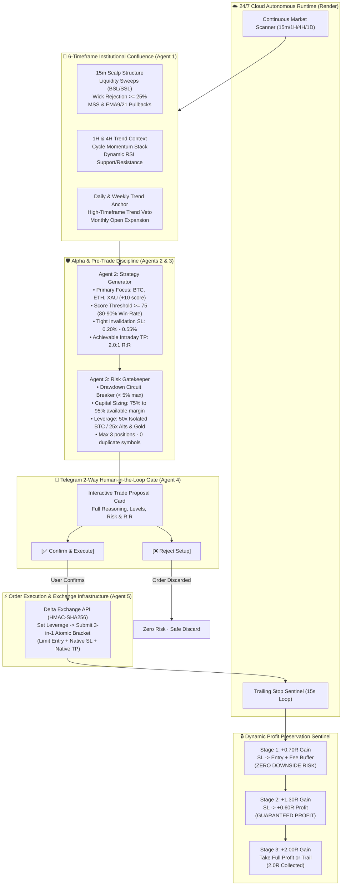

# ⚡ Delta Exchange Multi-Agent Trading System

<div align="center">

[](https://python.org)
[](https://delta.exchange)
[](https://telegram.org)
[](https://render.com)
[](https://github.com/mohitxhkr/Multi_agent_trading_bot)
[](LICENSE)

**An institutional-grade, disciplined multi-agent algorithmic trading system engineered for Delta Exchange perpetual futures.**  
*Specialized for Intraday Scalping on **BTC, ETH, and XAU (Gold)** with Smart Money Concepts (SMC), 15m Microstructure Sweeps, 80–90% Precision Filters, +0.70R Breakeven Protection, and 24/7 Autonomous Cloud Operation.*

</div>

---

## 🏛️ System Architecture



---

## 📥 Visual Architecture Diagrams

For offline review and print presentations:
* **[High-Resolution Graphic (SVG Vector Diagram)](workflow_architecture_diagram.svg)**
* **[Interactive HTML Architecture Viewer](workflow_architecture.html)**
* **[PNG Architecture Diagram](workflow_architecture_diagram.png)**

---

## 🌟 Primary Focus Assets & Intraday Scalping Discipline

The system categorizes tradable instruments into two prioritized tiers to maximize edge:

| Tier | Assets | Leverage | Minimum Score | Primary Focus & Characteristics |
| :--- | :--- | :--- | :--- | :--- |
| **Tier 1 (PRIMARY)** | **`BTCUSD`**, **`ETHUSD`**, **`XAUUSD` (Gold)** | **50x (BTC)<br/>25x (ETH/XAU)** | **$\ge$ 75** (+10 Priority Boost) | **Core Focus.** Deep institutional liquidity, tight spreads, and clean 15-minute microstructure sweeps. Prioritized in scanning and Telegram proposals. |
| **Tier 2 (SECONDARY)** | `SOLUSD`, `ADAUSD`, `DOGEUSD`, `XRPUSD` | **25x Isolated** | **$\ge$ 80** | Subordinate assets evaluated only when Tier-1 assets are in dead consolidation. |

---

## 🎯 How the 80%–90% Win-Rate Standard is Achieved

In professional intraday scalping, win-rate is driven by **rigorous confluence entry filters** paired with an **aggressive breakeven defense**:

### 1. The 5-Layer Confluence Matrix
1. **Macro Trend Guard (4H & 1D):** Never buy intraday pullbacks into a confirmed Daily/Weekly downtrend (unless capitulation RSI $< 32$). Never short into confirmed HTF bull expansion (unless overbought RSI $> 68$).
2. **15m Liquidity Sweeps:** Trades trigger exclusively when retail stop-losses are swept above structural highs (BSL) or below structural lows (SSL).
3. **Rejection Wick ($\ge 25\%$):** The sweep candle must show an absorption wick covering at least a quarter of its full range, verifying that smart money absorbed the move.
4. **Market Structure Shift (MSS):** The bot waits for the following candle to close back beyond the sweep extreme, confirming directional reversal.
5. **Score Threshold ($\ge 75$):** Eliminates low-probability chop.

### 2. Tight Invalidation & Realistic Same-Day Targets
* **Stop Loss:** Clamped between **0.20% and 0.55%** of price (e.g. BTC ~$200–$350, ETH ~$6–$10).
* **Take Profit:** Fixed at **2.0:1 Reward-to-Risk ratio** (e.g. BTC ~$400–$700 move, ETH ~$12–$20 move). These targets comfortably complete within 1 to 4 hours.

### 3. The Micro-Trailing Capital Shield
* **At +0.70R Profit:** Stop Loss is **instantly modified on Delta Exchange to Entry + 0.05% fee buffer**. Downside risk is completely eradicated (free roll).
* **At +1.30R Profit:** Stop Loss is trailed to **+0.60R locked profit**, guaranteeing a green trade even during sudden market reversals.
* **At +2.00R Profit:** Full Take Profit target fills on the orderbook.

---

## 🤖 The Multi-Agent Trading Team

| Agent | Module | Role & Core Responsibilities |
| :--- | :--- | :--- |
| **Agent 1: Regime Analyst** | `multiagent_team/regime_analyst.py` | 6-timeframe analysis (15m, 1H, 4H, 1D, 1W, 1M). Computes EMA stacks (9/21/50/200), RSI, ATR, and Smart Money Concepts liquidity pools. |
| **Agent 2: Strategy Generator** | `multiagent_team/strategy_agent.py` | Evaluates technical edge, scores candidates (0–100), applies Primary Asset boost, and calculates tight SL and 2.0R TP bounds. |
| **Agent 3: Risk Gatekeeper** | `multiagent_team/risk_gatekeeper.py` | Absolute veto authority. Enforces account circuit breaker ($< 5\%$ daily drawdown), sizes 75%–95% margin at 50x/25x leverage, and enforces R:R $\ge 1.5:1$. |
| **Agent 4: Telegram Two-Way Gate** | `src/telegram_bot.py` | Sends rich interactive proposal card with inline buttons. Requires explicit user tap (`[Confirm]` / `[Reject]`) before any order executes. |
| **Agent 5: Execution Engine** | `multiagent_team/execution_agent.py` | Signs HMAC-SHA256 authenticated requests. Sets leverage and places native 3-in-1 atomic bracket orders on Delta Exchange. |
| **Agent 6: Trailing Stop Sentinel** | `src/trailing_stop_manager.py` | 15-second background loop. Detects order fills, moves stops to Breakeven (+0.70R), locks profit (+1.30R), and notifies Telegram of exits. |

---

## 📱 Telegram 2-Way Gate & Interactive Commands

The system is controlled via Telegram bot (`@DeltaTradenotifier_bot`):

### Trade Proposal Preview:
```text
🚨 [HIGH PROBABILITY TRADE SETUP]
• Symbol: BTCUSD 🟢 LONG (🌟 PRIMARY FOCUS ASSET)
• Strategy: Intraday_Scalp_SSL_Sweep_15m (Score: 85/100)
━━━━━━━━━━━━━━━━━━━━━━
• Entry: $78,557.00 (Limit Bracket)
• Stop Loss: $78,319.06 (Risk: 0.30% / $237.94)
• Take Profit: $79,032.88 (Target: 2.0:1 R:R / +$475.88)
━━━━━━━━━━━━━━━━━━━━━━
• Position Size: 15 contracts (50x Isolated Leverage)
• Required Margin: $23.57 USD | Max Risk: $3.57 USD
• Plan: Move to BE at +0.70R -> Lock +0.60R at +1.30R -> 2.0R Target
━━━━━━━━━━━━━━━━━━━━━━
[✅ Confirm & Execute]   [❌ Reject Setup]
```

### Supported In-Chat Slash Commands:
| Command | Action |
| :--- | :--- |
| `/scan` | Triggers an immediate multi-timeframe scan across all primary and secondary assets. |
| `/status` | Returns 24/7 cloud health, active positions, open orders, and available wallet balance. |
| `/positions` | Shows real-time mark prices, entry prices, liquidation distance, and unrealized PnL. |
| `/orders` | Displays active bracket Stop-Loss and Take-Profit orders on Delta Exchange. |
| `/help` | Displays command usage and help menu. |

---

## ⚙️ Environment Configuration (`.env`)

```ini
# Delta Exchange API Credentials
DELTA_ENVIRONMENT=testnet_india
DELTA_BASE_URL=https://cdn-ind.testnet.deltaex.org
DELTA_API_KEY=your_api_key_here
DELTA_API_SECRET=your_api_secret_here

# Asset Prioritization
PRIMARY_SYMBOLS=BTCUSD,ETHUSD,XAUUSD
DEFAULT_SYMBOLS=BTCUSD,ETHUSD,XAUUSD,SOLUSD,ADAUSD,DOGEUSD,XRPUSD

# Risk Management & Discipline Gates
MAX_RISK_PER_TRADE_PCT=0.05
MAX_CONCURRENT_POSITIONS=3
MAX_DAILY_DRAWDOWN_PCT=0.05
MIN_REWARD_TO_RISK_RATIO=1.5

# Leverage Directives
BTC_LEVERAGE=50
ALT_LEVERAGE=25
CAPITAL_ALLOCATION_MIN_PCT=0.75
CAPITAL_ALLOCATION_MAX_PCT=0.95

# Telegram 2-Way Gate
TELEGRAM_BOT_TOKEN=your_bot_token_here
TELEGRAM_CHAT_ID=your_chat_id_here
TELEGRAM_NOTIFICATIONS_ENABLED=true
```

---

## ☁️ Autonomous 24/7 Cloud Deployment

The system is deployed natively on **Render.com** via [`server.py`](server.py) and [`render.yaml`](render.yaml):

1. **Deploy to Render:** Connect your GitHub repository as a Web Service with start command `python server.py`.
2. **Keep-Alive Monitor:** Ping `https://your-service.onrender.com/health` every 5 minutes using [UptimeRobot](https://uptimerobot.com) to prevent cloud sleep.
3. **True Laptop-Closed Automation:** The bot scans markets continuously, monitors active orders every 15s, trails stops to breakeven, and pings your phone whenever an action is needed.

---

## 🚀 Local Quickstart & Commands

```bash
# 1. Clone repository
git clone https://github.com/mohitxhkr/Multi_agent_trading_bot.git
cd Multi_agent_trading_bot

# 2. Install dependencies
pip install -r requirements.txt

# 3. Test connectivity & Delta credentials
python main.py --test

# 4. Run instant multi-timeframe market scan
python main.py --scan

# 5. Run interactive trading engine (terminal confirmation)
python main.py --trade

# 6. Run background scanner (continuous local loop)
python run_247_scanner.py --interval 60
```

---

## 📂 Project Structure

```
Multi Agent Trading Bot/
├── multiagent_team/                  # The 6 Autonomous Agents
│   ├── orchestrator.py               # Central Multi-Agent Coordinator & Scan Pulse
│   ├── regime_analyst.py             # Agent 1: 6-Timeframe Structure & SMC Sweeps
│   ├── strategy_agent.py             # Agent 2: 80-90% Win-Rate Alpha Generator
│   ├── risk_gatekeeper.py            # Agent 3: Mathematical Sizing & Capital Allocation
│   ├── execution_agent.py            # Agent 5: Atomic Bracket Order Engine
│   └── portfolio_monitor.py          # Portfolio State & Trade Journal
├── src/                              # Core Infrastructure Engines
│   ├── delta_client.py               # HMAC-SHA256 Delta Exchange REST Client
│   ├── technical_analysis.py         # SMC Liquidity Sweeps, MSS & Indicators
│   ├── trailing_stop_manager.py      # 15s Trailing Sentinel (+0.7R BE, +1.3R Lock)
│   ├── telegram_bot.py               # Interactive 2-Way Telegram Gate & Commands
│   ├── telegram_notifier.py          # Rich Real-Time Lifecycle Notifications
│   ├── risk_manager.py               # Drawdown Circuit Breakers & R:R Verification
│   └── journal.py                    # Persistent Trade Journal & Performance
├── state/                            # Persistent Runtime State
│   ├── circuit_breaker_state.json    # Drawdown & daily loss tracker
│   ├── trailing_stop_state.json      # Live bracket trailing stages
│   └── trade_journal.json            # Completed trade histories
├── server.py                         # 24/7 Cloud Health Responder & Scanner Daemon
├── render.yaml                       # Cloud deployment specification
├── requirements.txt                  # Minimal Python dependencies
└── README.md                         # Documentation
```

---

## 🛡️ Risk Disclaimer

*Cryptocurrency derivatives and margin trading involve substantial risk of capital loss. The automated multi-agent architecture enforces strict mathematical capital gates, tight stop-loss invalidation, and human-in-the-loop Telegram confirmation, but past performance does not guarantee future results. Test thoroughly on Delta Exchange testnet before deploying real capital.*

---

## 📄 License

This project is licensed under the MIT License — see the [LICENSE](LICENSE) file for details.
