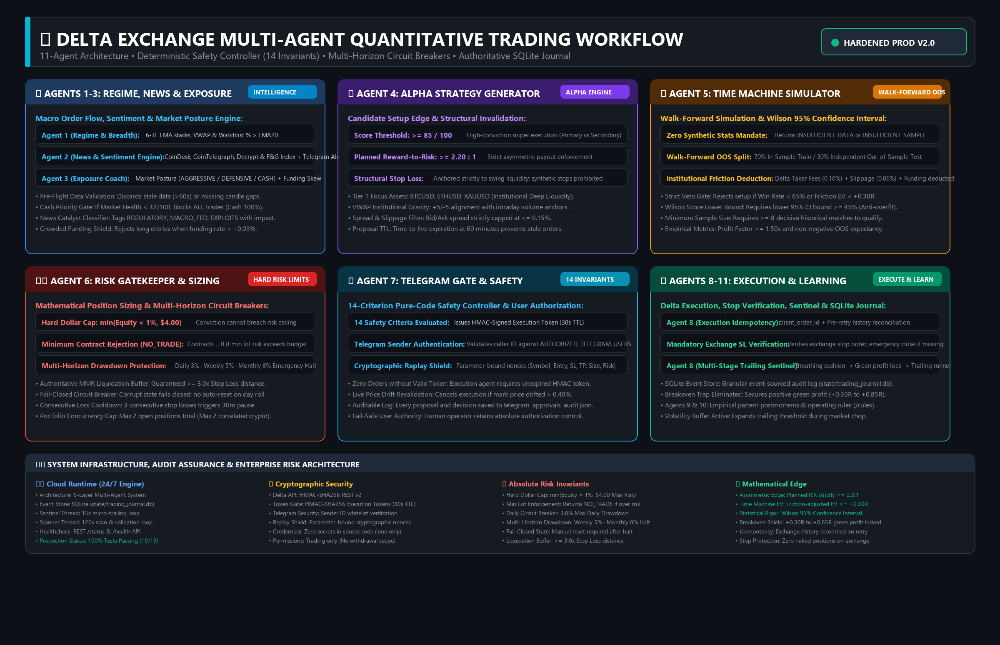
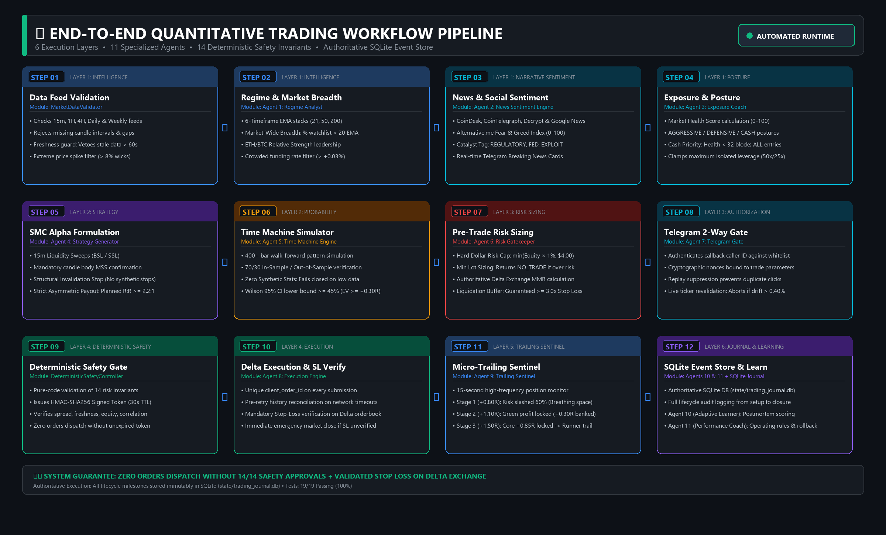

# ⚡ Delta Exchange Multi-Agent Quantitative Trading System

<div align="center">

[](https://python.org)
[](https://delta.exchange)
[](https://github.com/mohitxhkr/Multi_agent_trading_bot)
[](https://github.com/mohitxhkr/Multi_agent_trading_bot)
[-brightgreen?style=for-the-badge)](https://github.com/mohitxhkr/Multi_agent_trading_bot)
[](LICENSE)

**An institutional-grade, evidence-driven algorithmic trading system engineered for Delta Exchange perpetual futures.**  
*Specialized for rapid intraday scalping on **BTC, ETH, SOL, XRP, and XAU (Gold)** with Smart Money Concepts (SMC), 15m Liquidity Sweeps, Walk-Forward Probability Backtests, a 14-Criterion Deterministic Safety Controller, Multi-Horizon Circuit Breakers, Real-Time Portfolio Surveillance, and Controlled Adaptive Learning.*

</div>

---

## 📑 Table of Contents

- [🏛️ System Architecture](#️-system-architecture)
- [🔄 End-to-End System Workflow](#-end-to-end-system-workflow)
- [🤖 Detailed Breakdown of the 11 Specialized Agents](#-detailed-breakdown-of-the-11-specialized-agents)
  - [1. Market Regime Analyst](#1️⃣-agent-1-market-regime-analyst)
  - [2. News & Sentiment Engine](#2️⃣-agent-2-autonomous-news--social-sentiment-intelligence-engine)
  - [3. Exposure Coach](#3️⃣-agent-3-exposure-coach--market-posture-engine)
  - [4. Alpha Strategy Generator](#4️⃣-agent-4-alpha-strategy-generator)
  - [5. Time Machine Probability Engine](#5️⃣-agent-5-time-machine-probability-engine)
  - [6. Pre-Trade Risk Gatekeeper](#6️⃣-agent-6-pre-trade-risk-gatekeeper)
  - [7. Telegram Confirmation Gate](#7️⃣-agent-7-telegram-two-way-confirmation-gate)
  - [8. Delta Execution Engine](#8️⃣-agent-8-delta-execution-engine)
  - [9. Portfolio Monitor & Sentinel](#9️⃣-agent-9-portfolio-monitor--position-sentinel)
  - [10. Adaptive Learning Engine](#-agent-10-adaptive-learning-engine)
  - [11. Performance Coach](#1️⃣1️⃣-agent-11-performance-coach--operating-rules)
- [📁 Codebase Directory Structure](#-codebase-directory-structure)
- [📚 Quantitative Audit & Documentation Deliverables](#-quantitative-audit--documentation-deliverables)
- [🔒 Deterministic Safety Controller (14 Invariants)](#-deterministic-safety-controller-14-invariants)
- [🛡️ Persistent Multi-Horizon Circuit Breaker](#️-persistent-multi-horizon-circuit-breaker)
- [🗄️ Dual-Store Authoritative Event Journal](#️-dual-store-authoritative-event-journal)
- [🚀 Quickstart & Setup](#-quickstart--setup)
- [📄 License](#-license)

---

## 🏛️ System Architecture

<p align="center">
  
</p>

---

## 🔄 End-to-End System Workflow

<p align="center">
  
</p>

The system coordinates trade discovery, mathematical validation, and execution across **6 sequential layers** and **11 specialized agents**:

```mermaid
flowchart TD
    subgraph L1["Layer 1: Market Intelligence & Sentiment"]
        DV["MarketDataValidator<br/>• Freshness check (≤ 60s)<br/>• Gap & spike filtering"]
        A1["Agent 1: Regime Analyst<br/>• 4-TF (1H/15M/5M/1M) hierarchy<br/>• 9 canonical regimes & hysteresis<br/>• Watchlist breadth & confluence"]
        A2["Agent 2: News & Sentiment Engine<br/>• Live RSS feeds & F&G Index<br/>• Catalyst tagging & polarity<br/>• Zero Telegram spam"]
        A3["Agent 3: Exposure Coach<br/>• Macro Posture (0-100)<br/>• Dynamic leverage & risk caps<br/>• Cash Priority Gate"]
        DV --> A1 --> A2 --> A3
    end

    subgraph L2["Layer 2: Alpha Strategy & Probability"]
        A4["Agent 4: Strategy Generator<br/>• SMC BSL/SSL sweeps & MSS close<br/>• 50% FVG CE retests & wick reject<br/>• Order flow (VP, CVD, OBI)<br/>• Planned R:R ≥ 2.20:1"]
        A5["Agent 5: Time Machine Engine<br/>• Exact multi-TF strategy replay<br/>• 70/30 in/out-of-sample split<br/>• Wilson 95% CI (Lower ≥ 45%)<br/>• Zero synthetic data mandate"]
        A3 --> A4 --> A5
    end

    subgraph L3["Layer 3: Risk & Multi-Horizon Protection"]
        A6["Agent 6: Risk Gatekeeper<br/>• Hard dollar cap min(1%, USD 4.00)<br/>• Dynamic ATR contract sizing<br/>• Delta MMR buffer (≥ 3.0x SL)"]
        CB["Circuit Breaker Engine<br/>• Daily (3%), Weekly (5%), Monthly (8%)<br/>• Consecutive loss cooldown (30m)<br/>• Fail-closed persistent state"]
        A7["Agent 7: Telegram Gate<br/>• Caller ID whitelist auth<br/>• Parameter-bound nonces<br/>• Cancel on price drift > 0.40%"]
        A5 --> A6
        CB -.->|Drawdown Check| A6
        A6 --> A7
    end

    subgraph L4["Layer 4: Deterministic Safety & Execution"]
        DSC["Deterministic Safety Controller<br/>• 14 pure-code risk checks<br/>• Issues HMAC token (30s TTL)"]
        A8["Agent 8: Delta Execution Engine<br/>• Unique client_order_id<br/>• Pre-retry history reconcile<br/>• Mandatory stop verification<br/>• Emergency close if SL missing"]
        A7 --> DSC --> A8
    end

    subgraph L5["Layer 5: Portfolio Surveillance & Sentinel"]
        A9["Agent 9: Portfolio Monitor & Sentinel<br/>• Real-time position & margin audit<br/>• True mark-to-liq distance<br/>• Active stop verification & recovery<br/>• Multi-stage trailing profit lock"]
        SQL["Authoritative SQLite Event Store<br/>(state/trading_journal.db)"]
        A8 --> A9
        A8 --> SQL
        A9 --> SQL
    end

    subgraph L6["Layer 6: Continuous Learning & Rules"]
        A10["Agent 10: Adaptive Learning Engine<br/>• Net friction postmortem scoring<br/>• 12 failure modes taxonomy<br/>• Walk-forward parameter testing<br/>• Controlled 4-stage promotion"]
        A11["Agent 11: Performance Coach<br/>• Cohort variance analysis<br/>• Versioned rules & rollback guard"]
        A9 --> A10 --> A11
        A10 -.->|Parameter bounds & pattern scores| A4
    end
```



---

## 🤖 Detailed Breakdown of the 11 Specialized Agents

### 1️⃣ Agent 1: Market Regime Analyst
* **Module:** [`multiagent_team/regime_analyst.py`](multiagent_team/regime_analyst.py)
* **Core Task:** Classifies market trend, structural order flow, momentum, and relative asset strength across 4 hierarchical timeframes (1H direction, 15M structure, 5M primary setup, 1M execution refinement).
* **Inputs:** 1H, 15M, 5M, 1M candlestick series (strictly closed candles), Level-2 order books, and ticker statistics across BTC, ETH, SOL, XRP, and XAU.
* **Processing Logic:**
  * **9 Canonical Regimes:** Deterministically classifies market state into `STRONG_UPTREND`, `WEAK_UPTREND`, `STRONG_DOWNTREND`, `WEAK_DOWNTREND`, `RANGING`, `HIGH_VOLATILITY`, `LOW_VOLATILITY`, `TRANSITIONAL`, or `UNKNOWN`.
  * **Anti-Whipsaw Hysteresis:** Requires 2 consecutive confirmation candles before switching regimes to suppress false transitions during consolidations.
  * **Asset-Specific Calibrations:** Custom volatility, spread, and ADX thresholds optimized individually for BTC, ETH, SOL, XRP, and XAU.
  * **Zero Look-Ahead Bias:** Operates exclusively on completed candle closes (`data[:-1]` when last candle is active) with NaN and schema validation.
  * **Quantitative Confluence Stack:**
    * Computes 21, 50, and 200 EMAs, 14-period RSI, 14-period ADX, **Institutional VWAP with ±1σ/±2σ Standard Deviation Bands**, and **MACD (12, 26, 9)**.
    * Evaluates **VWAP Stance & Slope** (`ABOVE_VWAP` / `BELOW_VWAP`, `RISING_BULLISH` / `FALLING_BEARISH`, and Band Locations).
    * Evaluates **MACD Crossovers** (`BULLISH_CROSS` / `BEARISH_CROSS`), **Momentum Phase** (`BULLISH_EXPANSION` / `BEARISH_EXPANSION`), and **Zero-Line Stance**.
    * Measures **Market-Wide Breadth** (% of watchlist assets trading above 20 EMA, % with Bullish MACD, and % trading above Session VWAP) and **ETH/BTC Relative Strength**.
    * Computes **Multi-Timeframe ATR & Volatility State**: Evaluates 15m, 1H, and 4H ATR, ATR percentage of price, rolling 30-bar ATR expansion ratio, and rates volatility temperature (`CALM_COMPRESSION`, `NORMAL_VOLATILITY`, `HIGH_VOLATILITY_EXPANSION`, `EXTREME_VOLATILITY`).
    * Identifies **SMC Liquidity Pools & Sweeps**: Detects Buy-Side Liquidity (BSL) swing highs, Sell-Side Liquidity (SSL) swing lows, pool distance percentages, and classifies market structure state (`SWEEP_MSS_CONFIRMED`, `SWEEP_WICK_REJECTION`, `TESTING_BSL_LIQUIDITY`, `TESTING_SSL_LIQUIDITY`, `BALANCED_LIQUIDITY_CORE`).
    * Identifies **SMC Fair Value Gaps (FVG) & 50% Consequent Encroachment (CE)**: Detects 3-candle imbalance zones (Bullish FVG: `Candle 3 Low > Candle 1 High`; Bearish FVG: `Candle 3 High < Candle 1 Low`), computes 50% CE midpoint entries, and tracks full mitigation lifecycle (`UNTESTED`, `RETESTING`, `CE_RETESTED`, `MITIGATED`).
    * Computes **Institutional Volume Profile (VP)**: Calculates Point of Control (POC), Value Area High (VAH), Value Area Low (VAL) covering 70% of traded volume, High/Low Volume Nodes (HVN/LVN), and monitors price stance (`ABOVE_VAH`, `INSIDE_VA`, `BELOW_VAL`, `AT_POC`).
    * Computes **Cumulative Volume Delta (CVD) & Delta Divergences**: Evaluates intrabar aggressor delta curves, CVD accumulation/distribution trends, and flags **Bullish Absorption Divergence** and **Bearish Exhaustion Divergence**.
    * Evaluates **Level-2 Order Book Imbalance (OBI) & Whale Walls**: Aggregates top-10 bid/ask depth, calculates OBI ratio ($-1.0$ to $+1.0$), and detects resting liquidity walls ($\ge 35\%$ of side depth).
* **Output:** Deterministic typed `RegimeClassification` payload consumed directly by Strategy Agent, Exposure Coach, Risk Gatekeeper, and Orchestrator.

### 2️⃣ Agent 2: Autonomous News & Social Sentiment Intelligence Engine
* **Module:** [`multiagent_team/news_sentiment_agent.py`](multiagent_team/news_sentiment_agent.py)
* **Core Task:** Scrapes breaking crypto news across the internet, parses market catalysts, and computes composite sentiment to guide downstream trading agents.
* **Internal Intelligence Architecture (Zero Telegram Spam):**
  * **100% Dedicated to Trading Agents:** All scanned news headlines are ingested and scored strictly for internal multi-agent decision-making. No standalone news push notifications or digest spam are broadcast to Telegram.
  * **Trade Proposal Integration:** Crucial sentiment metrics (Fear & Greed Index, composite sentiment score, macro regime, and target asset bias) are embedded directly into the **Telegram Trade Proposal Card** when an actionable trade setup is found.
* **Ingestion Channels:**
  * **CoinDesk RSS & CoinTelegraph RSS:** Real-time institutional coverage, ETF flows, and protocol security events.
  * **Decrypt Media RSS:** On-chain developments, ecosystem announcements, and token dynamics.
  * **Google News Crypto RSS:** Aggregate headlines from Bloomberg, WSJ, Financial Times, and Reuters.
  * **Alternative.me Fear & Greed Index API:** Multi-factor community pulse (0-100 index).
* **Processing Logic:**
  * **Institutional Lexicon NLP:** Evaluates polarity (-1.0 to +1.0) and assigns sentiment labels (`VERY_BULLISH`, `BULLISH`, `NEUTRAL`, `BEARISH`, `VERY_BEARISH`).
  * **Catalyst Categorization:** Automatically classifies articles into `REGULATORY`, `MACRO_FED`, `INSTITUTIONAL`, `SECURITY_EXPLOIT`, and `MARKET_ACTION`.
  * **Target Asset Mapping:** Detects mentions of `BTC`, `ETH`, `SOL`, `XRP`, `DOGE`, and `GOLD`.
  * **Critical Catalyst Filter:** Isolates true market movers using `CRITICAL_MARKET_MOVER_PHRASES` while eliminating `CLICKBAIT_NOISE_PHRASES`.
  * **Future Sentiment Guidance:** Generates actionable guidance for other agents (e.g. Clamps risk during extreme fear; widens stop loss buffer by 15% during high-impact news).
* **Output:** Typed `MarketSentimentReport` feeding Exposure Coach and embedded inside Trade Proposal cards.

### 3️⃣ Agent 3: Exposure Coach & Market Posture Engine
* **Module:** [`multiagent_team/exposure_coach.py`](multiagent_team/exposure_coach.py)
* **Core Task:** Dictates capital exposure, allowable leverage, and portfolio risk posture based on macro health and news sentiment.
* **Inputs:** Agent 1 breadth, VWAP, & MACD metrics, Agent 2 news sentiment composite scores, account margin utilization, and consecutive loss history.
* **Processing Logic:**
  * Assesses Market Health score (0 to 100) combining 21 EMA structure, **Institutional VWAP Breadth**, **MACD Momentum Breadth**, and **Watchlist Average ATR Volatility**.
  * Dynamic ATR Guardrails: Clamps risk scalar (0.70x) and limits max concurrent positions to 1 during extreme market-wide volatility spikes (> 3.5% ATR), while signaling explosive expansion readiness during volatility compression (< 1.0% ATR).
  * Enforces Postures:
    * `AGGRESSIVE_EXPANSION` (Health >= 75): 100% risk budget, up to 2 concurrent positions.
    * `MODERATE_SELECTIVE` (Health 50-74): 75% risk budget, restricted to Tier-1 (`BTC`, `ETH`, `XAU`).
    * `DEFENSIVE_CAUTION` (Health 32-49): 50% risk budget, max 1 open trade.
    * `RECOVERY_POSTURE`: Triggered after 2 consecutive losses; cuts risk by 50% and clamps leverage.
    * `CASH_PRIORITY` (Health < 32): **0% risk budget. All new entries blocked.** Capital is 100% in cash USD.
* **Output:** Operational posture, leverage caps, and asset whitelist.

### 4️⃣ Agent 4: Alpha Strategy Generator
* **Module:** [`multiagent_team/strategy_agent.py`](multiagent_team/strategy_agent.py)
* **Core Task:** Formulates high-conviction scalping setups using Smart Money Concepts (SMC), multi-timeframe order flow, and volatility-calibrated structural stops.
* **Timeframe Hierarchy:**
  * **1H:** Directional trend bias, EMA 50/200 orientation, and macro regime alignment.
  * **15M:** Market structure pivots, BSL/SSL liquidity sweep validation, and Fair Value Gaps.
  * **5M:** Primary entry trigger, Market Structure Shift (MSS) body close, and 50% FVG Consequent Encroachment (CE) retests.
  * **1M:** Execution entry refinement and micro-spread checks.
* **Processing Logic:**
  * **Closed-Candle Execution:** Evaluates signals strictly on closed candles (`data[:-1]`) to prevent intra-candle repaint and lookahead bias.
  * **SMC Sweeps & Market Structure Shift (MSS):** Vetoes unconfirmed wicks; strictly mandates candle body closes beyond structural swing highs/lows.
  * **FVG 50% Consequent Encroachment (CE):** Identifies 3-bar imbalance zones; awards bonus score for 50% CE retests confirmed by wick rejections; penalizes setups entering directly into opposing unmitigated gaps.
  * **Dynamic ATR Stop Calibration:** Buffers stops beyond structural swing pivots with dynamic ATR cushions (0.80x to 1.25x ATR). Enforces hard vetoes on micro-stops (< 0.40x ATR) and loose stops (> 3.0x ATR).
  * **Institutional VWAP & MACD Confluence:** Validates pullbacks into rising VWAP bands; penalizes overextended entries beyond ±2σ; mandates momentum alignment with MACD histogram and signal crosses.
  * **Order Flow Confluence:** Evaluates Cumulative Volume Delta (CVD) absorption divergences, Order Book Imbalance (OBI), and Volume Profile (POC/VAH/VAL).
  * **Mathematical Risk-to-Reward:** Strictly enforces minimum planned R:R $\ge 2.20:1$.
  * **Asset-Calibrated Confluence Floors:** Composite score threshold $\ge 85/100$ for Primary assets (`BTC`, `ETH`, `XAU`) and $\ge 90/100$ for Secondary assets (`SOL`, `XRP`).
* **Output:** Candidate trade setups with bounded 60-minute time-to-live (TTL).

### 5️⃣ Agent 5: Time Machine Probability Engine
* **Module:** [`multiagent_team/time_machine_agent.py`](multiagent_team/time_machine_agent.py)
* **Core Task:** Simulates candidate trade setups through exact historical replay across market history to ensure statistically significant positive expectancy.
* **Inputs:** Candidate setup parameters, historical multi-timeframe candle data (1H context + 15M/5M execution), rolling VWAP, and zero-lookahead indicator series.
* **Processing Logic:**
  * **Exact Strategy Replay:** Accurately reproduces Agent 4's multi-timeframe conditions (1H EMA trend bias, 15M structural sweeps, and 5M entry triggers) rather than generic heuristic filters.
  * **Zero Synthetic Stats Mandate:** If candles < 60, returns `INSUFFICIENT_DATA`. If historical matches < 8, returns `INSUFFICIENT_SAMPLE`. Never fabricates hypothetical wins, backtest numbers, or synthetic fills.
  * **Intrabar Simulation Standard:** Employs conservative same-bar pathing: if a single bar touches both Stop-Loss and Take-Profit, the loss is registered first.
  * **Dynamic Breakeven & Timeout:** Automatically simulates trailing stops to breakeven (+1.0R threshold) and enforces a 48-bar timeout exit on stagnant trades.
  * **Walk-Forward Separation:** Chronological 70% in-sample training / 30% out-of-sample forward verification to ensure out-of-sample regime resilience.
  * **Institutional Net Friction:** Deducts Delta maker/taker exchange fees (0.10%), adverse slippage (0.06%), and rolling funding rates from every trade.
  * **Wilson 95% Confidence Interval:** Requires Wilson lower confidence bound $\ge 45\%$ to guard against small-sample variance.
  * **Statistical Approval Gates:** Overall Win Rate $\ge 65\%$, Friction Expected Value (EV) $\ge +0.30\text{R}$, Profit Factor $\ge 1.50\text{x}$, and positive OOS EV.
* **Output:** Statistical approval or veto with empirical validation metrics.

### 6️⃣ Agent 6: Pre-Trade Risk Gatekeeper
* **Module:** [`multiagent_team/risk_gatekeeper.py`](multiagent_team/risk_gatekeeper.py)
* **Core Task:** Enforces account risk budgets, authoritative contract sizing, and exchange margin rules.
* **Inputs:** Net equity, available balance, product specifications (lot size, contract value, MMR), open positions.
* **Processing Logic:**
  * **Hard Dollar Ceiling:** Capped at `min(Equity * max_risk_pct, $4.00)`. High conviction cannot inflate dollar risk.
  * **ATR Volatility Position Sizing:** Position contracts scale dynamically with ATR stop distance:
    $$\text{Contracts} = \left\lfloor \frac{\text{Calculated Dollar Risk}}{(\text{Contract Value} \times \text{ATR Stop Distance}) + \text{Friction}} \right\rfloor$$
    Automatically scales down position size during high volatility and scales up during low volatility, locking dollar loss to the exact budget (`$2.00` – `$4.00` USD).
  * **SMC Fair Value Gap Audit Profile:** Tags authoritative `fvg_profile` (active retest state, CE tap confirmation, wick rejection status, and nearest FVG distance) into the approved trade specification for execution provenance and postmortem learning.
  * **Order Flow Audit Profile & Hard Safety Gate:** Attaches `order_flow_profile` (Volume Profile POC/VAH/VAL, CVD trend/divergence, OBI ratio) to approved specs. Strictly vetoes buying if extreme ask dominance blocks the path (OBI $\le -0.50$) or shorting if extreme bid dominance blocks the path (OBI $\ge +0.50$).
  * **Pre-Trade ATR Volatility Sanity Gate:** Hard veto on setups with micro-stops (< 0.40x ATR) or loose stops (> 3.0x ATR).
  * **Minimum Lot Protection:** If the minimum contract risk exceeds the risk budget, returns `gate_decision: "NO_TRADE"` and `contracts: 0`.
  * **Pre-Trade Order Book Liquidity Gate:** Hard veto on illiquid books where the bid-ask spread exceeds 0.150% (slippage prevention). Approved setups are graded with institutional depth ratings (`A+_PRIME_DEPTH`, `HIGH_DEPTH`, `STANDARD_DEPTH`).
  * **MMR Liquidation Buffer:** Verifies liquidation price is >= 3.0x stop loss distance away; automatically de-leverages if buffer is insufficient.
  * **Correlated Exposure Gate:** Clamps concurrent directional crypto trades to a maximum of 2.
* **Output:** Sized trade orders or strict `NO_TRADE` / `REJECTED` decisions.

### 7️⃣ Agent 7: Telegram Two-Way Confirmation Gate
* **Module:** [`src/telegram_bot.py`](src/telegram_bot.py)
* **Core Task:** Provides secure human authorization through interactive Telegram messages with integrated market sentiment intelligence.
* **Inputs:** Approved trade specifications from Agent 6 and sentiment report from Agent 2.
* **Processing Logic:**
  * **Comprehensive Trade Proposal Card:** Displays quality score, risk-to-reward profile, exact entry/SL/TP, contracts, margin, and backtest results.
  * **Market Sentiment & Fear/Greed Pulse:** Embeds live Alternative.me Fear & Greed index (`78/100 Extreme Greed`), macro composite polarity (`🟢 BULLISH BIAS`), and symbol-specific sentiment directly into the proposal card.
  * **Sender Authentication:** Authenticates Telegram user ID against `AUTHORIZED_TELEGRAM_USERS`.
  * **Parameter-Bound Nonces:** Binds approvals to exact trade parameters; replayed nonces are rejected.
  * **Price Drift Revalidation:** Re-queries Delta Exchange mark price upon callback click; cancels trade if price drifted > 0.40%.
  * **Auditable History:** Logs all requests, timestamps, and confirmations in `state/telegram_approvals_audit.json`.
* **Output:** User authorization confirmation or timeout rejection.

### 8️⃣ Agent 8: Delta Execution Engine
* **Module:** [`multiagent_team/execution_agent.py`](multiagent_team/execution_agent.py)
* **Core Task:** Submits orders with exchange-level idempotency and validates protective stops.
* **Inputs:** Approved trade setup, signed safety token, Delta REST client.
* **Processing Logic:**
  * Validates HMAC execution token issued by the Deterministic Safety Controller.
  * Assigns unique `client_order_id`.
  * **Pre-Retry Reconciliation:** If an ambiguous network timeout occurs, queries Delta Exchange order history and open orders before retrying to prevent duplicate fills.
  * **Mandatory Stop-Loss Verification:** Verifies the protective stop exists on the exchange. If missing, places an emergency reduce-only stop. If stop placement fails, immediately executes an emergency market close.
* **Output:** Verified open position or emergency abort record.

### 9️⃣ Agent 9: Portfolio Monitor & Position Sentinel
* **Module:** [`multiagent_team/portfolio_monitor.py`](multiagent_team/portfolio_monitor.py) & [`src/trailing_stop_manager.py`](src/trailing_stop_manager.py)
* **Core Task:** Continuously monitors live positions, margin utilization, unrealized PnL, mark-to-liquidation distances, exchange synchronization, and active protective stops.
* **Inputs:** Live exchange positions, open stop/take-profit orders, wallet balances, mark prices, and StateManager journal state.
* **Processing Logic:**
  * **Exchange as Source of Truth:** Reconciles live positions against local state; flags desynchronization and orphaned orders.
  * **Protective Stop Verification:** Continuously verifies an active, reduce-only stop-loss order exists on the exchange for every open position. If missing or mis-sized (due to partial fills), triggers automatic emergency placement or market liquidation.
  * **True Mark-to-Liquidation Distance:** Uses exchange liquidation price (or derives precise isolated margin liquidation) to enforce safe distance buffers. Dispatches immediate alerts if liquidation is within 3.0x stop-loss distance.
  * **Margin & Drawdown Surveillance:** Monitors margin utilization against warning (70%) and critical (85%) thresholds; coordinates with EmergencyController and circuit breakers.
  * **Concentration & Asset Exposure:** Enforces portfolio limits (max 50% notional in a single asset, max concurrent positions).
  * **Multi-Stage Trailing Stop Sentinel:**
    * **Stage 1 (Breathing Cushion):** At +0.80R, slashes risk by 60% (moves SL to -0.40R), giving room for normal retests.
    * **Stage 2 (Guaranteed Green Lock):** At +1.10R, locks +0.30R profit to eliminate breakeven drag.
    * **Stage 3 (Core Expansion):** At +1.50R, locks +0.85R profit.
    * **Stage 4 (Trailing Runner):** Dynamically trails mark price using volatility-scaled ATR cushions.
* **Output:** Continuous portfolio health snapshots, deduplicated Telegram risk alerts, and emergency stop triggers.

### 🔟 Agent 10: Adaptive Learning Engine
* **Module:** [`multiagent_team/adaptive_learning.py`](multiagent_team/adaptive_learning.py)
* **Core Task:** Conducts rigorous, evidence-based postmortems on closed trades to optimize strategy parameters without uncontrolled live mutations.
* **Inputs:** Authoritative trade records from `trading_journal.db` / `trade_journal.json`, completed trade PnL, exit reasons, MFE/MAE, and market regime context.
* **Processing Logic:**
  * **Strict Data Provenance:** Learns exclusively from verified, closed trades with complete execution lifecycles. Open or ambiguous positions are rejected.
  * **Net Friction Accounting:** Incorporates actual exchange taker/maker fees, recorded slippage, and funding costs into all PnL and R-multiple calculations.
  * **12 Loss Failure Modes:** Granularly tags every losing trade with canonical failure taxonomies (`PREMATURE_STOP_OUT`, `SLIPPAGE_DEGRADATION`, `REGIME_MISMATCH`, `CHOP_WHIPSAW`, `VOLATILITY_EXPANSION`, `LIQUIDITY_RUN`, `SPREAD_EROSION`, `ADVERSE_FUNDING`, `EXECUTION_DELAY`, `TIMEOUT_STAGNATION`, `FALSE_BREAKOUT`, `UNSPECIFIED_FAILURE`).
  * **Walk-Forward Validation:** Validates all parameter updates across chronological splits (minimum 10 trades per split, max 25% performance degradation allowed) to prevent recency bias.
  * **4-Stage Controlled Promotion Lifecycle:**  
    `EXPERIMENTAL` ➔ `SHADOW` ➔ `CANARY` ➔ `LIVE_APPROVED`
    * Requires statistical significance ($N \ge 30$, Profit Factor $\ge 1.30$, Win Rate $\ge 55\%$) and human confirmation before live application.
    * **Automated Rollback Guard:** Reverts active parameters to known-good baseline (`1.0.0-PROD`) if live rolling performance degrades by $> 20\%$.
* **Output:** Versioned strategy parameter profiles and pattern score modifiers.

### 1️⃣1️⃣ Agent 11: Performance Coach & Operating Rules
* **Module:** [`multiagent_team/performance_coach.py`](multiagent_team/performance_coach.py)
* **Core Task:** Monitors macro performance cohorts and maintains version-controlled operating rules.
* **Inputs:** Historical journal metrics, rolling win rates, and strategy drawdowns.
* **Processing Logic:**
  * Analyzes performance variance across asset cohorts, trading sessions, and strategies.
  * Maintains institutional operating rules in `state/active_operating_rules.json`.
  * Enforces automated rollbacks if rolling win rates degrade over a 20-trade evaluation window.
* **Output:** Dynamic operating rules and performance reports.

---

## 📁 Codebase Directory Structure

The project follows a clean, professional modular architecture separating core infrastructure, autonomous agents, standalone CLI utilities, comprehensive test suites, and structured documentation:

```text
Multi_agent_trading_bot/
├── docs/                               # 📚 Complete System Documentation & Audits
│   ├── architecture/                   # System diagrams, specifications & technical PDFs
│   │   ├── workflow_architecture_diagram.png
│   │   ├── end_to_end_workflow.png
│   │   ├── SYSTEM_DOCUMENTATION.md
│   │   ├── Delta_Exchange_Comprehensive_MultiAgent_Architecture.pdf
│   │   └── Delta_Exchange_MultiAgent_Trading_System_Documentation.pdf
│   ├── agents/                         # In-depth agent specifications & prompt definitions
│   │   ├── delta-team-prompts.md
│   │   ├── REGIME_ANALYST_DOCUMENTATION.md
│   │   ├── STRATEGY_AGENT_DOCUMENTATION.md
│   │   ├── TIME_MACHINE_DOCUMENTATION.md
│   │   ├── PORTFOLIO_MONITOR_DOCUMENTATION.md
│   │   └── ADAPTIVE_LEARNING_DOCUMENTATION.md
│   ├── guides/                         # Setup guides, beginner tutorials & deployment
│   │   ├── SETUP_GUIDE.md
│   │   ├── HOW_TO_USE_BEGINNER_GUIDE.md
│   │   ├── CLOUD_DEPLOYMENT_FREE_TIER.md
│   │   └── Delta_Trading_Beginners_Guide.pdf
│   ├── reports/                        # Testing reports, safety audits & readiness verification
│   │   ├── MASTER_SYSTEM_AUDIT.md
│   │   ├── DEPLOYMENT_READINESS_REPORT.md
│   │   ├── IMPROVEMENT_AUDIT.md
│   │   ├── UPGRADE_REPORT.md
│   │   └── MASTER_SYSTEM_TESTING_REPORT.md
│   └── changelogs/                     # Historical changelogs and version release notes
│       ├── MASTER_SYSTEM_CHANGELOG.md
│       ├── ADAPTIVE_LEARNING_CHANGELOG.md
│       ├── PORTFOLIO_MONITOR_CHANGELOG.md
│       ├── REGIME_ANALYST_CHANGELOG.md
│       ├── STRATEGY_AGENT_CHANGELOG.md
│       └── TIME_MACHINE_CHANGELOG.md
├── multiagent_team/                    # 🤖 11 Specialized Autonomous Trading Agents
│   ├── orchestrator.py                 # Multi-agent master pipeline orchestrator
│   ├── regime_analyst.py               # Agent 1: 4-TF market structure & 9 canonical regimes
│   ├── news_sentiment_agent.py         # Agent 2: Live sentiment intelligence & F&G Index
│   ├── exposure_coach.py               # Agent 3: Macro posture & dynamic risk modulation
│   ├── strategy_agent.py               # Agent 4: Institutional SMC, liquidity sweep & FVG engine
│   ├── time_machine.py                 # Agent 5: Walk-forward probability & Wilson CI backtest
│   ├── risk_gatekeeper.py              # Agent 6: Risk sizing, lot boost, margin & liquidation safety
│   ├── deterministic_safety_controller.py # Layer 4: 14 deterministic safety invariants & token issuance
│   ├── execution_agent.py              # Agent 8: Precision order execution & scale-in pyramiding
│   ├── portfolio_monitor.py            # Agent 9: 24/7 position sentinel, margin & desync surveillance
│   ├── adaptive_learning.py            # Agent 10: Closed-loop learning & parameter lifecycle
│   ├── performance_coach.py            # Agent 11: Trading cohort analytics & operating rules
│   ├── data_validator.py               # Pre-flight tick, candle, & orderbook validation
│   └── system_monitor.py               # Telemetry, execution latency & rejection recorder
├── src/                                # ⚙️ Core Infrastructure & Shared Libraries
│   ├── config.py                       # Pydantic system settings & env parser
│   ├── delta_client.py                 # Delta Exchange REST/WebSocket client (India & Global)
│   ├── telegram_bot.py                 # Interactive 2-way Telegram confirmation bot & command router
│   ├── telegram_notifier.py            # Push notification dispatcher (fills, alerts, digests)
│   ├── candlestick_chart.py            # Institutional dark-theme 15m candlestick chart generator
│   ├── technical_analysis.py           # EMA, RSI, ATR, VWAP, ADX, MACD & order flow analytics
│   ├── risk_manager.py                 # Multi-horizon circuit breakers (Daily/Weekly/Monthly)
│   ├── trailing_stop_manager.py        # 10s background trailing stop manager & break-even shield
│   ├── emergency_controller.py         # One-click emergency flatten & state freeze controller
│   ├── journal.py                      # SQLite & JSON dual-store authoritative trade event journal
│   ├── state_manager.py                # In-memory & disk state manager with atomic persistence
│   └── delta_mcp_server.py             # Model Context Protocol (MCP) server for IDE integration
├── scripts/                            # 🛠️ Standalone Utilities & Helper CLI Tools
│   ├── send_market_levels.py           # Pre-trade breakout/breakdown level scanner & dispatcher
│   ├── send_morning_news.py            # 10 AM IST crypto morning briefing dispatcher
│   ├── run_247_scanner.py              # Standalone 24/7 background scanner runner
│   ├── run_telegram_listener.py        # Standalone Telegram polling listener runner
│   ├── test_delta_connection.py        # Quick Delta Exchange API credential verification tool
│   └── run_mcp.py                      # Fast MCP server launch script
├── tests/                              # 🧪 Comprehensive Unit & Integration Test Suite (157 Tests)
│   ├── test_telegram_single_poller_and_trade.py # Single-poller synchronization & /trade test
│   ├── test_lot_boost_and_scale_in.py  # Historical lot boost & scale-in pyramiding tests
│   ├── test_p0_security_and_risk.py    # Zero-trust security & risk guardrail test suite
│   ├── test_full_pipeline.py           # End-to-end multi-agent pipeline integration test
│   ├── test_regime_analyst_upgrade.py  # Regime analyst multi-timeframe structure tests
│   ├── test_strategy_agent_upgrade.py  # SMC liquidity sweep & FVG strategy tests
│   ├── test_time_machine_upgrade.py    # Empirical walk-forward simulation tests
│   ├── test_portfolio_monitor_upgrade.py # Real-time position sentinel & margin tests
│   ├── test_adaptive_learning_upgrade.py # Postmortem learning & rollback tests
│   ├── test_news_sentiment.py          # News ingestion & sentiment scoring tests
│   ├── test_breakout_levels.py         # Breakout/breakdown key level calculation tests
│   ├── test_macd_analysis.py           # MACD cross & momentum expansion tests
│   ├── test_fvg_analysis.py            # Fair value gap detection & mitigation tests
│   └── test_order_flow_analysis.py     # Volume profile & order book imbalance tests
├── state/                              # 💾 Persistent Local State & Journals (.gitignored)
│   ├── charts/                         # High-res generated candlestick chart PNGs
│   ├── trading_journal.db              # SQLite authoritative event ledger
│   └── *.json                          # Operational state, operating rules & circuit breakers
├── main.py                             # 🚀 Unified CLI Tool (test, scan, trade, auto, mcp, digest)
├── server.py                           # 🌐 Cloud Production Entrypoint (HTTP healthcheck & 24/7 scanner)
├── requirements.txt                    # Project Python dependencies
├── Dockerfile                          # Cloud container build manifest
├── Procfile                            # Cloud process declaration (`web: python server.py`)
├── render.yaml                         # Production Render infrastructure-as-code specification
├── .gitignore                          # Git exclusion rules
├── .env.example                        # Environment variable documentation template
└── LICENSE                             # Open source MIT license
```

---

## 📚 Quantitative Audit & Documentation Deliverables

Comprehensive engineering documentation, mathematical specifications, empirical testing reports, and changelogs are available for the audited agents:

| Specialized Agent | Technical Documentation | Testing Report (100% Pass) | Test Suite Implementation | Migration Changelog |
|:---|:---|:---|:---|:---|
| **Agent 1: Regime Analyst** | [Architecture & Mathematical Specs](docs/agents/REGIME_ANALYST_DOCUMENTATION.md) | [16 Unit Tests Suite Report](docs/reports/REGIME_ANALYST_TESTING_REPORT.md) | [`test_regime_analyst_upgrade.py`](tests/test_regime_analyst_upgrade.py) | [Audit & Upgrade Changelog](docs/changelogs/REGIME_ANALYST_CHANGELOG.md) |
| **Agent 4: Strategy Generator** | [SMC & Order Flow Confluence](docs/agents/STRATEGY_AGENT_DOCUMENTATION.md) | [18 Unit Tests Suite Report](docs/reports/STRATEGY_AGENT_TESTING_REPORT.md) | [`test_strategy_agent_upgrade.py`](tests/test_strategy_agent_upgrade.py) | [Audit & Upgrade Changelog](docs/changelogs/STRATEGY_AGENT_CHANGELOG.md) |
| **Agent 5: Time Machine Engine** | [Historical Simulation & Wilson CI](docs/agents/TIME_MACHINE_DOCUMENTATION.md) | [12 Unit Tests Suite Report](docs/reports/TIME_MACHINE_TESTING_REPORT.md) | [`test_time_machine_upgrade.py`](tests/test_time_machine_upgrade.py) | [Audit & Upgrade Changelog](docs/changelogs/TIME_MACHINE_CHANGELOG.md) |
| **Agent 9: Portfolio Monitor** | [Real-Time Surveillance & Margin](docs/agents/PORTFOLIO_MONITOR_DOCUMENTATION.md) | [22 Unit Tests Suite Report](docs/reports/PORTFOLIO_MONITOR_TESTING_REPORT.md) | [`test_portfolio_monitor_upgrade.py`](tests/test_portfolio_monitor_upgrade.py) | [Audit & Upgrade Changelog](docs/changelogs/PORTFOLIO_MONITOR_CHANGELOG.md) |
| **Agent 10: Adaptive Learning** | [Postmortem & Parameter Lifecycle](docs/agents/ADAPTIVE_LEARNING_DOCUMENTATION.md) | [22 Unit Tests Suite Report](docs/reports/ADAPTIVE_LEARNING_TESTING_REPORT.md) | [`test_adaptive_learning_upgrade.py`](tests/test_adaptive_learning_upgrade.py) | [Audit & Upgrade Changelog](docs/changelogs/ADAPTIVE_LEARNING_CHANGELOG.md) |

---

## 🔒 Deterministic Safety Controller (14 Invariants)

Positioned immediately before Agent 7, [`multiagent_team/deterministic_safety_controller.py`](multiagent_team/deterministic_safety_controller.py) validates 14 pure-code safety criteria:

| # | Safety Check | Verification Criterion | Failure Action |
|---|--------------|------------------------|----------------|
| **1** | Circuit Breaker | System state must be `TRADING_ALLOWED` (not `HALTED`, `EMERGENCY`, or `COOLDOWN`) | Execution Aborted |
| **2** | Net Equity Floor | Account net equity must be `≥ $10.00` | Execution Aborted |
| **3** | Portfolio Concurrency | Total open positions must be `< max_portfolio_concurrency` (default: 2) | Execution Aborted |
| **4** | Dollar Risk Cap | Risk must be `≤ min(Equity × max_risk_pct, $4.00)` | Execution Aborted |
| **5** | Leverage Ceiling | Leverage must be `≤ max_allowed_leverage` | Execution Aborted |
| **6** | Stop Orientation | `SL < Entry` for Longs; `SL > Entry` for Shorts; `SL > 0` | Execution Aborted |
| **7** | Reward-to-Risk | Planned R:R ratio must be `≥ 2.20:1` | Execution Aborted |
| **8** | Liquidation Buffer | Liquidation distance must be `≥ 3.0x` stop loss distance | Execution Aborted |
| **9** | Whitelist Check | Symbol must exist in approved whitelist | Execution Aborted |
| **10** | Spread Threshold | Orderbook bid/ask spread must be `≤ 0.20%` | Execution Aborted |
| **11** | Feed Freshness | Candlestick and mark price timestamp must be `≤ 60` seconds old | Execution Aborted |
| **12** | Correlation Limit | Same-side crypto positions must be `≤ max_correlated_positions` (2) | Execution Aborted |
| **13** | Idempotency Check | `client_order_id` must not already exist in registered records | Execution Aborted |
| **14** | Human Authorization | Telegram signature must be valid and non-expired | Execution Aborted |

> **Token Issuance:** When all 14 criteria pass, the controller generates an HMAC-SHA256 signature containing the trade parameters and a **30-second time-to-live (TTL)**. Orders lacking a valid token are rejected by the execution engine.

---

## 🛡️ Persistent Multi-Horizon Circuit Breaker

The circuit breaker in [`src/risk_manager.py`](src/risk_manager.py) enforces persistent risk limits across multiple horizons:

* **Daily Drawdown Limit:** 3.0% max daily loss -> `HALTED`
* **Weekly Drawdown Limit:** 5.0% max weekly loss -> `HALTED`
* **Monthly Drawdown Limit:** 8.0% max monthly loss -> `EMERGENCY`
* **Consecutive Loss Limit:** 3 consecutive stop losses -> `COOLDOWN` (30 minutes)
* **Fail-Closed State Loader:** If state files are missing or unreadable, the system defaults to `HALTED`.
* **Administrative Reset Only:** The system does not resume automatically upon day rollover. Resuming requires an explicit call to `manual_reset(authorized_by, reason, current_equity)`.

---

## 🗄️ Dual-Store Authoritative Event Journal

The journaling engine in [`src/journal.py`](src/journal.py) logs granular events to both SQLite and JSON:

1. **SQLite Event Store (`state/trading_journal.db`):** Tracks granular lifecycle records (`SETUP_IDENTIFIED`, `RISK_EVALUATED`, `USER_PROMPTED`, `USER_DECISION_RECEIVED`, `ORDER_PLACED`, `ORDER_FILLED`, `PROTECTIVE_ORDER_PLACED`, `TRAILING_STOP_MODIFIED`, `EXIT_ORDER_FILLED`, `TRADE_CLOSED`, `POSTMORTEM_COMPLETED`).
2. **JSON Summary Store (`state/trade_journal.json`):** Maintains backward-compatible records for quick querying and Telegram status reporting.

---

## 🚀 Quickstart & Setup

### 1. Clone & Install Dependencies
```bash
git clone https://github.com/mohitxhkr/Multi_agent_trading_bot.git
cd Multi_agent_trading_bot
pip install -r requirements.txt
```

### 2. Configure Environment (`.env`)
```bash
# Delta Exchange API Credentials
DELTA_ENVIRONMENT=india
DELTA_API_KEY=your_delta_api_key_here
DELTA_API_SECRET=your_delta_api_secret_here

# Telegram Two-Way Gate Credentials
TELEGRAM_BOT_TOKEN=your_telegram_bot_token_here
TELEGRAM_CHAT_ID=your_telegram_chat_id_here
AUTHORIZED_TELEGRAM_USERS=your_telegram_chat_id_here

# Risk Limits
MAX_RISK_PER_TRADE_PCT=0.01          # 1% equity risk per trade
MAX_DOLLAR_RISK_PER_TRADE=4.00        # $4.00 hard cap
MAX_DAILY_DRAWDOWN_PCT=0.03          # 3% daily limit
MAX_WEEKLY_DRAWDOWN_PCT=0.05         # 5% weekly limit
MAX_MONTHLY_DRAWDOWN_PCT=0.08        # 8% monthly limit
MAX_CONSECUTIVE_LOSSES=3             # Cooldown after 3 losses
COOLDOWN_SECONDS=1800                # 30-minute cooldown
MAX_CONCURRENT_POSITIONS=2           # Max 2 simultaneous trades
MAX_ALLOWED_LEVERAGE=50              # Leverage ceiling
MIN_REWARD_TO_RISK=2.2               # Minimum 2.2:1 R:R
```

### 3. Run Test Suite

Run the full 157-test institutional validation suite:
```bash
python -m unittest discover tests
```
*Expected Output: `Ran 157 tests in ~2.5s - OK (100% Passing)`*

Or execute individual agent upgrade test suites:
```bash
python -m unittest tests.test_regime_analyst_upgrade      # 16 tests
python -m unittest tests.test_strategy_agent_upgrade      # 18 tests
python -m unittest tests.test_time_machine_upgrade        # 12 tests
python -m unittest tests.test_portfolio_monitor_upgrade   # 22 tests
python -m unittest tests.test_adaptive_learning_upgrade   # 22 tests
```

### 4. CLI Commands & Bot Execution

* **Test Delta Exchange Connectivity & Verify Credentials:**
  ```bash
  python main.py test
  ```

* **Launch Model Context Protocol (MCP) Server (Claude Desktop / Cursor / Antigravity):**
  ```bash
  python main.py mcp
  ```

* **Scrape Internet News & Post Sentiment Digest to Telegram:**
  ```bash
  python main.py news --telegram
  ```

* **Single Multi-Agent Market Scan:**
  ```bash
  python main.py scan --symbols BTCUSD,ETHUSD
  ```

* **Interactive Trading Mode (Requires Telegram Human Approval):**
  ```bash
  python main.py trade --symbols BTCUSD --leverage 25
  ```

* **Autonomous Continuous Execution (24/7 Cloud Background Loop):**
  ```bash
  python main.py auto --interval 300
  ```

* **View Trade Journal & Performance Digest:**
  ```bash
  python main.py digest
  ```

---

## 📄 License
This project is licensed under the MIT License — see the [LICENSE](LICENSE) file for details.
