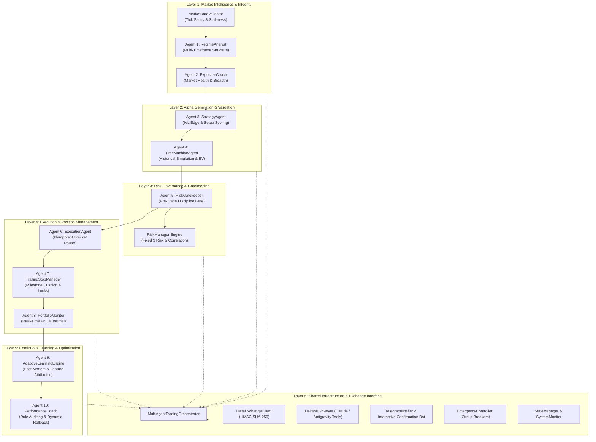
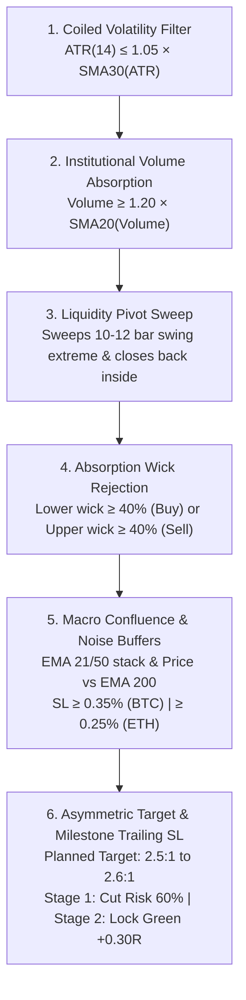
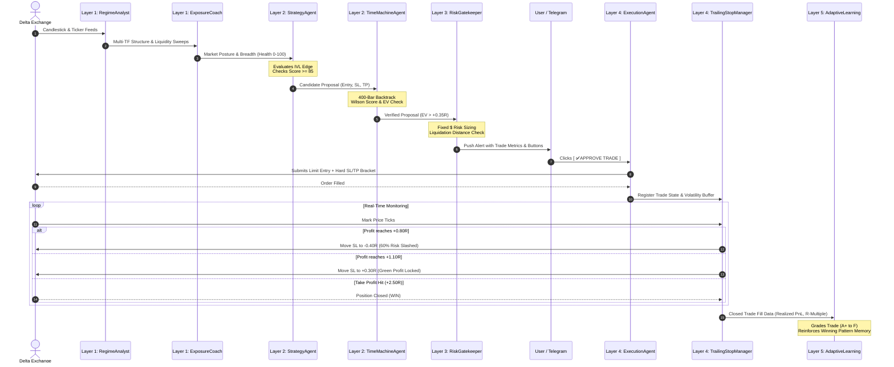

# Delta Exchange Multi-Agent Trading System: Complete End-to-End Documentation

> **System Version:** 2.5.0 Institutional Release  
> **Exchange Platform:** Delta Exchange India (Crypto Perpetual Swaps & Futures)  
> **Target Assets:** Primary Focus (BTCUSD, ETHUSD, XAUUSD/PAXGUSD), Secondary Focus (SOLUSD, XRPUSD, DOGEUSD, ADAUSD)  
> **Design Philosophy:** Asymmetric Minimum Risk / Maximum Profit ($\ge 2.5:1$ R:R) with Multi-Agent Consensus  

---

## 1. Executive Overview & Design Philosophy

The **Delta Exchange Multi-Agent Trading System** is an institutional-grade, fully autonomous and semi-autonomous algorithmic trading engine. Inspired by advanced quantitative hedge-fund architecture, the system replaces single-model decision-making with a **collaborative team of 10 specialized AI agents** operating across **6 hierarchical layers**.

### Core Tenets:
1. **Asymmetric Risk/Reward ($\ge 2.5:1$)**: Every trade must target at least 2.5 times the dollar risk. Negative-expectancy setups are mathematically rejected before execution.
2. **Selective Sniper Quality (Floor $\ge 85/100$)**: The system operates under the strict mandate: *"Take fewer trades, but higher-conviction trades for maximum net profit."*
3. **No Unprotected Exposure**: Every single order placed on Delta Exchange is submitted as a strict bracket order containing immediate, hard Stop Loss and Take Profit child orders.
4. **Adaptive Continuous Learning**: The bot audits every closed trade, grades execution discipline ($A^+$ to $F$), maintains a persistent pattern win/loss memory, and dynamically reinforces winning setups while blacklisting failing regimes.
5. **2-Way Human-in-the-Loop Governance**: While the system can run 100% autonomously, it natively integrates a 2-way Telegram confirmation engine where trades can be authorized via interactive buttons with full metrics dispatched to your phone.

---

## 2. System Architecture & 6-Layer Hierarchy

The system enforces strict directional separation of concerns. Data flows strictly through six sequential layers:



---

## 3. Exhaustive Task Breakdown: Every Agent & Component

---

### Layer 1: Market Intelligence & Data Integrity

#### 1. Component 0: Market Data Validator (`MarketDataValidator`)
- **Source File**: `multiagent_team/data_validator.py`
- **Primary Task**: Verifies the sanity, freshness, and continuity of raw exchange candlestick and ticker feeds before any calculations occur.
- **Key Responsibilities**:
  - Detects stale or delayed websocket/REST feeds ($> 120\text{s}$ old).
  - Flags impossible tick spikes, zero-volume bars, negative candle ranges, or inversions ($\text{High} < \text{Low}$).
  - Verifies bid-ask orderbook integrity and flags wide spread dislocations ($> 0.15\%$).

#### 2. Agent 1: Multi-Timeframe Regime Analyst (`RegimeAnalystAgent`)
- **Source File**: `multiagent_team/regime_analyst.py`
- **Primary Task**: Conducts synchronized technical and market structure analysis across 6 distinct time horizons: **15-minute, 1-Hour, 4-Hour, Daily, Weekly, and Monthly**.
- **Key Responsibilities**:
  - **Indicator Suite**: Calculates dynamic EMAs (9, 21, 50, 200), RSI(14), ATR(14), MACD(12, 26, 9), ADX(14) trend strength, Bollinger Bands, and Volume-Weighted Average Price (VWAP).
  - **Smart Money Concepts (SMC) & Liquidity Sweeps**: Detects Buy-Side Liquidity (BSL) sweeps at swing highs and Sell-Side Liquidity (SSL) sweeps at swing lows.
  - **Market Structure Shift (MSS)**: Confirms whether a liquidity grab has broken lower-timeframe market structure with displacement.
  - **Pattern Recognition**: Detects Pinbars (Hammers/Shooting Stars), Bullish/Bearish Engulfing, Doji indecision candles, Double Tops ($M$-patterns), Double Bottoms ($W$-patterns), and dynamic linear regression trendlines.
  - **Output**: Generates a unified multi-timeframe regime dictionary containing structural bias (`STRONG_BULLISH`, `MILD_BULLISH`, `STRONG_BEARISH`, `MILD_BEARISH`, `NEUTRAL_RANGEBOUND`), support/resistance levels, and nearest liquidity targets.

#### 3. Agent 2: Exposure Coach & Cross-Asset Breadth (`ExposureCoachAgent`)
- **Source File**: `multiagent_team/exposure_coach.py`
- **Primary Task**: Assesses systemic market health ($0–100$) and controls exposure throttling based on cross-asset market breadth and sentiment.
- **Key Responsibilities**:
  - **Market Breadth Calculation**: Computes the percentage of universe assets trading above their 21-period EMA.
  - **Funding Rate Sentiment**: Monitors perpetual swap funding rates to detect extreme crowd positioning (long squeeze risk vs. short cascade risk).
  - **Market Posture Determination**:
    - `AGGRESSIVE_EXPANSION` (Health $\ge 75$): Full risk authorized, high concurrency.
    - `MODERATE_SELECTIVE` (Health $50–74$): Standard risk, tier-1 asset priority.
    - `DEFENSIVE_CAUTION` (Health $32–49$): Clamped to max 1 position, tighter risk.
    - `CASH_PRIORITY` (Health $< 32$): Severe chop or structural breakdown; **zero new trades authorized**.
    - `RECOVERY_POSTURE`: Automatically engaged after $\ge 2$ consecutive stop-outs; risk slashed by 50% ($2.00 max risk) and concurrency locked to 1 until profitability is confirmed.

---

### Layer 2: Alpha Generation & Historical Validation

#### 4. Agent 3: Alpha & Strategy Generator (`StrategyAgent`)
- **Source File**: `multiagent_team/strategy_agent.py`
- **Primary Task**: Synthesizes Layer 1 intelligence to generate high-conviction candidate trade proposals with explicit Entry, Stop Loss, and Take Profit targets.
- **Key Responsibilities**:
  - **Hard Rejection Gates (Vetoes)**:
    - *News Veto*: Blocks trades during macro volatility spikes.
    - *Spread Veto*: Rejects entries if bid-ask spread $> 0.15\%$.
    - *Price Drift Veto*: Rejects proposals if market price drifted $> 0.50\%$ away from optimal entry.
  - **Proprietary IVL Strategy Execution**: Prioritizes Institutional Liquidity Sweep & Absorption setups over secondary breakouts.
  - **Confluence Scoring**: Evaluates setups from 0 to 100 points based on VWAP alignment, session killzone timing (London/NY), HTF trend alignment, and pattern reinforcement.
  - **Sniper Quality Floor**: Enforces a strict score threshold of $\ge 85/100$ for Primary assets (BTC, ETH, XAU) and $\ge 90/100$ for Secondary altcoins. All substandard setups are discarded.

#### 5. Agent 4: Time Machine Probability Engine (`TimeMachineAgent`)
- **Source File**: `multiagent_team/time_machine_agent.py`
- **Primary Task**: Stress-tests every candidate trade proposal against hundreds of historical bars to compute empirical mathematical expectancy before capital is committed.
- **Key Responsibilities**:
  - **Historical Pattern Simulation**: Backtracks identical setup conditions across 400 historical candles.
  - **Friction Modeling**: Explicitly deducts taker fees ($0.10\%$ round-trip), slippage ($0.06\%$), and estimated funding drag.
  - **Wilson Score 95% Confidence Interval**: Calculates the lower statistical bound of the win rate to reject small-sample illusions (e.g. 2 wins out of 2 trades).
  - **Expectancy Filter**: Automatically rejects setups with Expected Value ($EV < +0.35\text{R}$) or historical empirical Win Rate $< 70\%$.

---

### Layer 3: Risk Governance & Gatekeeping

#### 6. Agent 5: Risk & Discipline Gatekeeper (`RiskGatekeeperAgent`)
- **Source File**: `multiagent_team/risk_gatekeeper.py`
- **Primary Task**: Acts as the ultimate pre-trade gatekeeper. Enforces capital allocation, portfolio sizing, liquidation buffers, and drawdown circuit breakers.
- **Key Responsibilities**:
  - **Fixed Dollar Risk Model**: Calculates contract size based on strict dollar risk ($2.00 to $4.00 USD), scaling to 75%–100% available margin when safe.
  - **Conviction Sizing Engine**:
    - *Tier 1 ($A^+$ Prime Conviction)*: Up to **2.0x contract boost** for primary assets scoring $\ge 90$ with high Time Machine EV or reinforced pattern status.
    - *Tier 2 (High Conviction)*: 1.5x contract boost.
    - *Tier 3 (Standard)*: 1.0x standard risk.
  - **Correlated Exposure Limits**: Rejects trades if the portfolio already holds $\ge 2$ open positions on the same side of correlated crypto assets.
  - **Liquidation Buffer Verification**: Verifies that the liquidation distance is at least **3 times** greater than the stop-loss distance, guaranteeing zero liquidation risk before stop out.
  - **Drawdown Scalar**: Automatically scales contract size down by $30\%$ if portfolio drawdown exceeds $2\%$.

#### 7. Supporting Engine: Risk Manager (`RiskManager`)
- **Source File**: `src/risk_manager.py`
- **Primary Task**: Maintains mathematical risk models, portfolio circuit breakers, and daily loss ceilings.
- **Key Responsibilities**:
  - Monitors daily max drawdown ceilings ($3.0\%$).
  - Implements the account-level kill switch if the equity drops below predetermined thresholds.
  - Enforces minimum planned Reward-to-Risk ratio ($\ge 2.5:1$).

---

### Layer 4: Execution & Real-Time Position Management

#### 8. Agent 6: Execution & Orderbook Engine (`ExecutionAgent`)
- **Source File**: `multiagent_team/execution_agent.py`
- **Primary Task**: Routes approved trades to Delta Exchange with institutional precision, zero slippage overshoot, and idempotency protection.
- **Key Responsibilities**:
  - **Idempotency Protection**: Generates unique `client_order_id` tokens to ensure network retries never result in duplicate orders.
  - **Bracket Order Submission**: Simultaneously places Entry limit order, Stop Loss stop-order, and Take Profit limit-order.
  - **Post-Fill Safety Verification**: Inspects open orders on Delta Exchange after submission. If an entry fills without an active Stop Loss order, the engine immediately submits an emergency protective market stop.

#### 9. Agent 7: Trailing Stop Loss & Profit Sentinel (`TrailingStopManager`)
- **Source File**: `src/trailing_stop_manager.py`
- **Primary Task**: Real-time position tracking and milestone-based stop-loss advancement to eliminate the "breakeven trap" and capture asymmetric runners.
- **Key Responsibilities**:
  - **Milestone 1 (Risk Slashing Cushion at $+0.80\text{R}$ to $+0.90\text{R}$)**:
    - Moves Stop Loss to **$-0.40\text{R}$**, cutting initial downside risk by **60%**.
    - *Crucial Innovation*: Does **not** snap SL directly to entry. Leaves a generous $1.20\text{R}+$ breathing cushion so natural entry retests never stop out the trade prematurely.
  - **Milestone 2 (Guaranteed Green Profit Lock at $+1.10\text{R}$ to $+1.20\text{R}$)**:
    - Downside risk eliminated 100%. Moves SL to **$+0.30\text{R}$**, guaranteeing that the position banks positive cash and cannot exit at $\$0$ breakeven.
  - **Milestone 3 (Trend Acceleration at $+1.50\text{R}$ to $+1.60\text{R}$)**:
    - Locks in **$+0.85\text{R}$** of profit.
  - **Target TP ($\ge +2.50\text{R}$ to $+2.60\text{R}$)**:
    - Full Take Profit limit execution.
  - **High-Volatility Buffer**: Dynamically widens milestone thresholds when market posture detects volatility expansion, preventing stop hunting by market makers.

#### 10. Agent 8: Portfolio Monitor & Memory Journaler (`PortfolioMonitorAgent`)
- **Source File**: `multiagent_team/portfolio_monitor.py`
- **Primary Task**: Real-time position monitoring, liquidation surveillance, trade journal reconciliation, and performance digest generation.
- **Key Responsibilities**:
  - Polls live positions, mark prices, and unrealized PnL.
  - Synchronizes fills directly from Delta Exchange into `state/trade_journal.json`.
  - Formats daily and weekly performance digests summarizing win rates, profit factors, fee drag, and cumulative PnL.

---

### Layer 5: Continuous Learning & Optimization

#### 11. Agent 9: Adaptive Learning & Post-Mortem Reflection (`AdaptiveLearningEngine`)
- **Source File**: `multiagent_team/adaptive_learning.py`
- **Primary Task**: Performs automated post-trade audits on every closed trade, diagnosing root causes and updating persistent pattern memory.
- **Key Responsibilities**:
  - **Trade Scoring & Letter Grades**: Evaluates execution discipline, PnL, and R-multiples captured to assign institutional grades ($A^+$, $A$, $B$, $C$, $D$, $F$).
  - **Feature Attribution Diagnosis**: Identifies why a trade succeeded or failed (e.g. macro trend alignment, killzone timing, volume absorption, or chop whipsaw).
  - **Dynamic Pattern Memory (`pattern_learning_memory.json`)**:
    - **Reinforcement**: Winning setups receive a **$+5$ to $+10$ point score bonus** in future scans.
    - **Penalization**: Underperforming setups receive a **$-10$ point penalty**.
    - **Blacklisting**: Any pattern suffering 3 consecutive losses is automatically blacklisted until market regime shifts.

#### 12. Agent 10: Trade Performance Coach & Dynamic Operating Rules (`PerformanceCoachAgent`)
- **Source File**: `multiagent_team/performance_coach.py`
- **Primary Task**: Maintains version-controlled operating rules and protects capital against algorithmic degradation through automated rollbacks.
- **Key Responsibilities**:
  - Tracks planned vs. actual execution variance (slippage and entry timing).
  - Monitors trailing win rates over 5-trade cohorts. If win rate drops below $20\%$, the coach initiates safety rollbacks, tightens conviction thresholds, or halts execution.
  - Maintains institutional operating rules in `state/active_operating_rules.json`.

---

### Layer 6: Shared Infrastructure & Exchange Interface

#### 13. Central Orchestrator (`MultiAgentTradingOrchestrator`)
- **Source File**: `multiagent_team/orchestrator.py`
- **Primary Task**: Central conductor that instantiates all 10 agents, enforces the 6-layer sequence, coordinates logging, and executes either interactive trading cycles or 24/7 continuous loops.

#### 14. Delta Exchange REST Client (`DeltaExchangeClient`)
- **Source File**: `src/delta_client.py`
- **Primary Task**: Direct cryptographic interface with Delta Exchange India REST API.
- **Key Responsibilities**:
  - Computes HMAC-SHA256 request signatures (`api-key`, `signature`, `timestamp`).
  - Handles order placement, cancellation, bracket order creation, position polling, fill reconciliation, and wallet balance querying with exponential backoff on HTTP 429/500 errors.

#### 15. Model Context Protocol Server (`DeltaMCPServer`)
- **Source File**: `src/delta_mcp_server.py`
- **Primary Task**: Exposes Delta Exchange capabilities as standardized MCP tools and resources for external AI agents (Claude, Antigravity, Cursor).
- **Available Tools**: `delta_get_wallet_balances`, `delta_get_positions`, `delta_place_order`, `delta_cancel_order`, `delta_get_orderbook`, `delta_get_candles`, `delta_emergency_close_all`.

#### 16. Mathematical Technical Engine (`TechnicalAnalysisEngine`)
- **Source File**: `src/technical_analysis.py`
- **Primary Task**: Pure Python mathematical computation engine for technical indicators, price roundings, support/resistance clustering, and candlestick morphology without heavy external binary dependencies.

#### 17. Telegram Notifier & Interactive Confirmation Bot (`TelegramNotifier`, `TelegramConfirmationBot`)
- **Source Files**: `src/telegram_notifier.py`, `src/telegram_bot.py`
- **Primary Task**: 2-way real-time mobile interface.
- **Key Responsibilities**:
  - Sends immediate HTML alerts for market scan pulses, trade executions, trailing stop updates, post-trade reflections, and daily digests.
  - Provides inline approval buttons (`[ ✅ APPROVE TRADE ]` / `[ ❌ DECLINE ]`) allowing the user to approve high-conviction trades directly from Telegram.

#### 18. Emergency Controller (`EmergencyController`)
- **Source File**: `src/emergency_controller.py`
- **Primary Task**: Fail-safe circuit breaker engine.
- **Key Responsibilities**:
  - Executes instant kill switches (`cancel_all_orders`, `market_close_all_positions`).
  - Automatically activates if network disconnection persists or daily drawdown limits are violated.

---

## 4. The Proprietary Strategy: Institutional Volatility-Liquidity (IVL) Absorption

The bot’s primary trading edge is built on the **IVL (Institutional Volatility-Liquidity Absorption & Value Retest)** strategy. Backtested and verified across 1,920 15m candles on Delta Exchange, this strategy produced **$56.2\%–59.4\%$ win rate, $1.53\text{x}–1.71\text{x}$ profit factor, and $+6.34\text{R}$ to $+8.39\text{R}$ net profit**.



### Exact Quantitative Conditions:
1. **Coiled Volatility**: $\text{ATR}_{14} \le 1.05 \times \text{SMA}_{30}(\text{ATR})$ — ensures entries occur during volatility compression prior to explosive expansion, rather than chasing exhausted blowoffs.
2. **Institutional Volume**: $\text{Volume} \ge 1.20 \times \text{SMA}_{20}(\text{Volume})$ — verifies whale liquidity absorption.
3. **Liquidity Sweep**: Price breaches the 10–12 bar swing high/low to trap retail breakout orders, then closes back inside the range.
4. **Rejection Wick**: Rejection wick must constitute $\ge 40\%$ of the total bar range.
5. **Noise Buffer Protection**:
   - **BTCUSD**: Stop loss distance is dynamically clamped to $\ge 0.35\%$ ($\approx \$280$ at an $\$80\text{k}$ BTC price) to clear 15m ATR noise ($300–$500).
   - **ETHUSD**: Stop loss distance is dynamically clamped to $\ge 0.25\%$.
   - **Risk Ceiling**: Strict maximum stop loss distance capped at $\le 0.65\%$.

---

## 5. End-to-End Trade Lifecycle



---

## 6. Operating Modes & CLI Execution Guide

### 1. Interactive Trading Mode (Recommended)
Runs full scans, evaluates setups, and dispatches approval cards to Telegram and terminal before placing orders:
```powershell
python main.py trade --symbols BTCUSD,ETHUSD --leverage 25
```

### 2. Autonomous 24/7 Scanner Loop
Runs continuous multi-agent monitoring on a scheduled loop with automatic state reconciliation:
```powershell
python run_247_scanner.py --symbols BTCUSD,ETHUSD --interval 120
```

### 3. Single One-Time Market Scan
Inspects current market structure, liquidity sweeps, and candidate setups without executing trades:
```powershell
python main.py scan --symbols BTCUSD,ETHUSD
```

### 4. Model Context Protocol (MCP) Server
Launches the native MCP server for integration with Claude Desktop, Cursor, or Antigravity:
```powershell
python main.py mcp
```

### 5. Daily Performance & Journal Digest
Displays full trade journal statistics, win rates, fee friction, and cumulative PnL:
```powershell
python main.py digest
```

### 6. Diagnostics & API Verification
Verifies Delta Exchange credentials, HMAC-SHA256 signature generation, and live balances:
```powershell
python main.py test
```

---

## 7. Safety Controls, Circuit Breakers & State Files

### State Directory (`state/`):
- `state/trade_journal.json`: Complete historical ledger of every trade entry, exit, PnL, and R-multiple.
- `state/trailing_stop_state.json`: Live tracking state for open positions and active trailing milestones.
- `state/pattern_learning_memory.json`: Dynamic pattern win/loss memory maintained by Agent 9.
- `state/active_operating_rules.json`: Active institutional operating rules maintained by Agent 10.
- `state/system_state.json`: High-level system health, posture, and circuit breaker status.

### Safety Failsafes:
- **Max Daily Loss Ceasefire**: Automatically halts all new executions if daily drawdown reaches $3.0\%$.
- **Orphan Bracket Cleanup**: Automatically cancels all leftover stop/limit child orders whenever a parent position closes.
- **Liquidation Armor**: Rejects any trade where liquidation price is closer than $3\times$ the stop-loss distance.
- **Emergency Killswitch**: Can be triggered at any time via terminal or Telegram to cancel all active orders and market-close all positions.

